# Thanodi — Frontend Specification

> **For the coding agent (Cursor).** This is the single source of truth for building Thanodi's frontend.
> Read sections 0–4 before writing any code. Each screen in section 7 has a written spec. Screenshots,
> where they exist, are an extra reference. **If a screenshot and this text disagree, follow this text.**

**Product:** Thanodi, a video-first tutoring web app for Botswana (students, parents, tutors)
**Scope of this document:** frontend only (UI, routing, components, client state, mock data)
**Screens designed:** 28 (2 live-lesson screens + 11 student + 8 parent + 7 tutor)
**Last updated:** 22 October 2026

---

## Contents

0. [How to use this document](#0-how-to-use-this-document)
1. [What Thanodi is](#1-what-thanodi-is)
2. [Tech stack and project conventions](#2-tech-stack-and-project-conventions)
3. [Design system](#3-design-system)
4. [App shell and navigation](#4-app-shell-and-navigation)
5. [Roles and permissions](#5-roles-and-permissions)
6. [Route map and screen index](#6-route-map-and-screen-index)
7. [Screen specifications](#7-screen-specifications)
8. [Key flows (diagrams)](#8-key-flows-diagrams)
9. [Shared component inventory](#9-shared-component-inventory)
10. [Data model and mock data](#10-data-model-and-mock-data)
11. [Formatting, copy and localisation](#11-formatting-copy-and-localisation)
12. [Responsive behaviour](#12-responsive-behaviour)
13. [Accessibility](#13-accessibility)
14. [Performance and low-data design](#14-performance-and-low-data-design)
15. [Build order and acceptance checklist](#15-build-order-and-acceptance-checklist)
16. [Placeholders and open decisions](#16-placeholders-and-open-decisions)

---

## 0. How to use this document

### 0.1 Rules for the agent

1. **Build the UI against mock data first.** Do not connect Supabase, Stream Video or a payment
   provider yet. Put every read and write behind the functions in `src/lib/data/` (section 10.3),
   so real services can replace the mocks later without touching components.
2. **Use the design tokens in section 3. Never hard-code colours** in components. Every colour comes
   from a CSS variable or Tailwind token.
3. **Use shadcn/ui components** (Base UI base, Vega style) wherever one exists. Build custom
   components only for the ones listed in section 9.
4. **Navigation comes from one config** (`src/config/nav.ts`, section 4.3). Every page of a role must
   show the same sidebar. This was a real problem in early designs, so don't hand-write menus.
5. **Do not invent features** that aren't in this document. If something is unclear, leave a
   `// TODO(spec):` comment and pick the simplest option.
6. **Keep placeholders visible.** Values like `[PRICE]`, `[RATE]`, `[AMOUNT]`, `[PAYMENT PROVIDER]` and
   `[LIMIT]` are undecided business values. Render them from constants in `src/config/placeholders.ts`
   so they're easy to find and replace.
7. **Curricula and subjects come only from `src/lib/curricula.ts`.** Never type subject lists by hand.

### 0.2 Screenshots

Screenshots of the designs go in `docs/design/screens/` using the filenames in section 6.2. Each screen
section in section 7 links its image like this:

```md
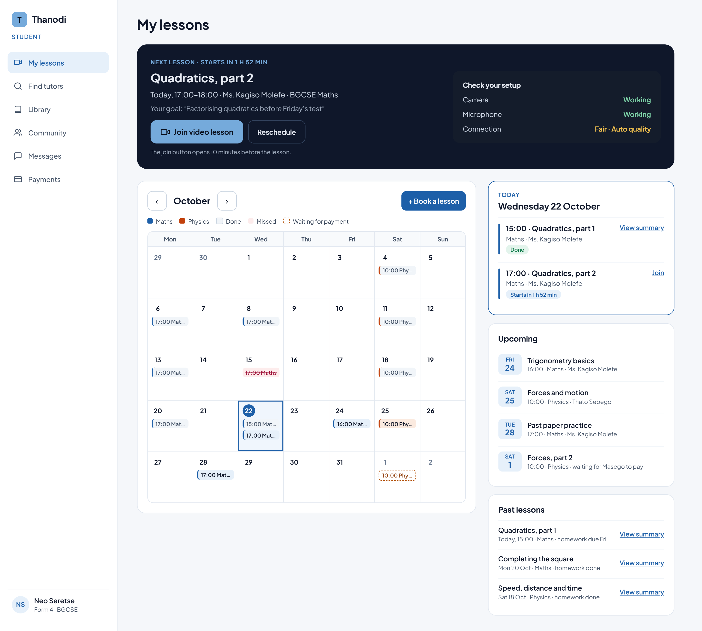
```

If an image is missing, build from the written spec, the layout sketch and the tokens. The text is
complete without the images.

Every Mermaid diagram in this file also has a rendered PNG copy in `docs/diagrams/`, numbered in the
order it appears (`01-sitemap-student.png` … `12-entities.png`).

### 0.3 Reading the layout sketches

The layout sketches in section 7 use these conventions:

```
┌───┐  a card or panel          [Button]   a button        (•) ( )  radio options
│   │                            [▾ Select]  a select       [x] [ ]  checkboxes
└───┘                            ‹ ›         prev / next     ●━━○     a switch (on)
━━━━  progress bar               ( chip )    a pill / chip   ▒▒▒      image / video area
```

---

## 1. What Thanodi is

Thanodi ("dictionary" in Setswana) connects students in Botswana with tutors for **live one-to-one
video lessons** with a shared whiteboard. Parents follow their children's progress and pay. Students
can also find and pay for tutors themselves.

### 1.1 Who uses it

| Role | Who | Main jobs |
| --- | --- | --- |
| **Student** | Primary to A Level / IB learners. Older students may earn their own money. | Join lessons, read lesson summaries, study in the Library, ask the Community, find and book tutors, pay or ask a parent to pay |
| **Parent** | Pays for and supervises one or more children | See children's calendar and reports, find and book tutors, pay (including children's payment requests), message tutors, manage children's permissions |
| **Tutor** | Teachers, university students, specialists | Teach lessons, write after-class reports, set availability and prices, choose what they teach, share resources, track earnings |

### 1.2 Product principles (these affect UI decisions)

- **Video is the core, voice is the fallback.** The live lesson defaults to video. Voice-only and
  data-saver modes are always one tap away, because mobile data in Botswana is expensive.
- **Parents can see everything for under-18s.** Messages between a child and a tutor stay on the
  platform and are visible to the linked parent. Phone numbers and outside links are hidden.
- **Card payments only (Visa/Mastercard)** in v1. Mobile money comes later.
- **Web-first, phone-friendly.** Tutors mostly use laptops, while students and parents often use
  phones. Every screen must work at 360px wide.
- **Botswana curricula first:** PSLE, JCE, BGCSE, BSSE, plus international IGCSE, IB and A Levels.

### 1.3 The demo cast (use these in mock data)

| Person | Role | Details |
| --- | --- | --- |
| **Neo Seretse** | Student | Form 4 · Secondary · Public · BGCSE. Takes Maths, Physics, Chemistry, Biology, English, Setswana, Geography. Has his own Visa debit card •••• 7310. |
| **Lesego Seretse** | Student | Standard 6 · Primary · PSLE (entire curriculum). Cannot book or pay herself. |
| **Masego Seretse** | Parent | Mother of Neo and Lesego. Visa •••• 4821 (default), Mastercard •••• 0937. Thanodi Plus subscriber. |
| **Ms. Kagiso Molefe** | Tutor | Maths teacher, 6 years. BGCSE/BSSE/JCE/IGCSE Maths. P150 per hour. Rating 4.9, 310 lessons. |
| **Thato Sebego** | Tutor | University engineering student. Physics, Science, BGCSE Maths. P90 per hour. |
| Boitumelo Kgosi, Onalenna Mosweu, Lorato Dintwe, Gofaone Nkwe, Refilwe Kgari | Tutors | Other tutors in search results (section 10.4) |

**"Today" in all mock data is Wednesday 22 October 2026**, in the Africa/Gaborone time zone.

---

## 2. Tech stack and project conventions

### 2.1 Stack

| Concern | Choice | Notes |
| --- | --- | --- |
| Framework | **Next.js (App Router)**, TypeScript | Created with `create-next-app`: Tailwind, ESLint, `src/` directory, `@/*` alias |
| Styling | **Tailwind CSS v4** | Tokens as CSS variables (section 3.8) |
| UI kit | **shadcn/ui**, base **Base UI**, style **Vega** | Components copied into `src/components/ui/` |
| Icons | **lucide-react** | 18px in nav, 16–22px elsewhere, stroke width 2 |
| Font | **Plus Jakarta Sans** via `next/font/google` | Weights 400, 500, 600, 700 |
| Charts | shadcn `chart` (Recharts) | Only used on Tutor · Earnings |
| Whiteboard | **Excalidraw** (`@excalidraw/excalidraw`) | Loaded with `next/dynamic`, client-only, lesson page only |
| Video (later) | **Stream Video React SDK** | v1 frontend uses a mock `VideoStage` (section 7.1) |
| Backend (later) | Supabase | Not connected in this phase |
| Toasts | shadcn `sonner` | |
| Dates | `date-fns` + `date-fns-tz` | Time zone `Africa/Gaborone` |

### 2.2 Folder structure

```
src/
  app/
    layout.tsx                 # fonts, <Toaster/>, html lang="en"
    globals.css                # tokens (section 3.8)
    (auth)/login/page.tsx      # not designed yet (section 16)
    lesson/[lessonId]/page.tsx # live lesson room, full screen, no sidebar
    student/
      layout.tsx               # <AppShell role="student">
      lessons/page.tsx
      lessons/[lessonId]/page.tsx
      tutors/page.tsx
      tutors/[tutorId]/book/page.tsx
      library/page.tsx
      community/page.tsx
      community/[questionId]/page.tsx
      community/leaderboard/page.tsx
      messages/page.tsx
      payments/page.tsx
      profile/page.tsx
    parent/
      layout.tsx               # <AppShell role="parent">
      page.tsx                 # Home
      calendar/page.tsx
      tutors/page.tsx
      tutors/[tutorId]/book/page.tsx
      reports/page.tsx
      messages/page.tsx
      payments/page.tsx
      profile/page.tsx
    tutor/
      layout.tsx               # <AppShell role="tutor">
      page.tsx                 # Today
      calendar/page.tsx
      students/page.tsx
      resources/page.tsx
      messages/page.tsx
      earnings/page.tsx
      profile/page.tsx
  components/
    ui/                        # shadcn (generated)
    shell/                     # AppShell, RoleSidebar, MobileNav, AccountChip, PageHeader
    shared/                    # StatusPill, StatCard, EmptyState, Avatar, SectionCard…
    lessons/                   # MonthCalendar, DayPanel, LessonRow, LessonSummary…
    tutors/                    # CurriculumFilter, TutorCard, TeachingPicker…
    booking/                   # SlotPicker, WhoPaysPicker, CardForm, OrderSummary…
    lesson-room/               # VideoStage, CallControls, QualitySwitch, Whiteboard…
    messages/                  # ThreadList, ChatThread, MessageBubble, LessonOfferCard…
    community/                 # QuestionCard, AnswerCard, PointsCard…
    payments/                  # SavedCards, PaymentHistoryTable…
  config/
    nav.ts                     # role menus (section 4.3)
    placeholders.ts            # [PRICE], [RATE]… (section 16)
  lib/
    curricula.ts               # provided file: curricula → categories → subjects
    data/                      # data-access functions (mock now, Supabase later)
    mock/                      # mock fixtures (section 10.4)
    format.ts                  # currency, dates, times (section 11)
    types.ts                   # domain types (section 10.2)
docs/
  FRONTEND_SPEC.md             # this file
  design/screens/*.png         # exported design screenshots
```

### 2.3 Conventions

- **Server Components by default.** Add `"use client"` only to interactive pieces such as filters,
  calendars, the lesson room, forms and switches.
- Page components fetch from `src/lib/data/*` (mock now) and pass plain props to client components.
- Use one component per file, named in PascalCase, with props typed using `type XProps = {…}`.
- Use Tailwind classes that map to tokens (`bg-primary`, `text-muted-foreground`,
  `bg-status-success-bg`…), not arbitrary hex values.
- Every interactive element is a real `<button>`, `<a>` or `<input>` (section 13).

---

## 3. Design system

The look is **calm, trustworthy and school-friendly**: a white card UI on a cool grey background,
one confident blue for actions, a sky-blue brand accent, and dark navy panels for "hero" information
such as the next lesson, your plan or your payout. The live lesson room is the only dark screen.

### 3.1 Colour tokens

#### Core

| Token | Hex | Used for |
| --- | --- | --- |
| `--background` | `#F5F7FA` | App page background |
| `--card` | `#FFFFFF` | Cards, sidebar, inputs |
| `--foreground` | `#0F172A` | Primary text, headings |
| `--text-secondary` | `#334155` | Body text in cards, labels |
| `--muted-foreground` | `#475569` | Secondary text, captions, inactive nav |
| `--text-faint` | `#64748B` | Disabled text, other-month dates |
| `--border` | `#E2E8F0` | Card and sidebar borders, dividers |
| `--input` | `#CBD5E1` | Input, select and secondary-button borders |
| `--divider-soft` | `#F1F5F9` | Row dividers inside cards, neutral chip background |
| `--surface-subtle` | `#F8FAFC` | Table headers, inset boxes inside cards |

#### Brand and action

| Token | Hex | Used for |
| --- | --- | --- |
| `--primary` | `#1D5FA8` | Primary buttons, links, active nav text, selected chip border |
| `--primary-hover` | `#164A84` | Link and button hover |
| `--primary-foreground` | `#FFFFFF` | Text on primary |
| `--accent` | `#E6F0FA` | Active nav background, selected chip background, info boxes |
| `--accent-foreground` | `#1D5FA8` | Text on accent |
| `--brand-sky` | `#75AADB` | Logo mark background, accent buttons on dark panels, eyebrow text on navy |
| `--brand-sky-foreground` | `#0B1220` | Text on brand-sky |
| `--navy` | `#0F172A` | "Hero" panels (next lesson, plan, payout, points) |
| `--navy-raised` | `#141C2B` | Inset box inside a navy panel |
| `--navy-border` | `#33445F` | Outline buttons on navy |
| `--on-navy` | `#E6EAF2` | Text on navy |
| `--on-navy-muted` | `#C9D2E0` / `#9AA6B8` | Secondary text on navy (two levels) |
| `--link-on-navy` | `#8CC2F0` | Links on navy |

#### Status (always pair a background with its foreground)

| Status | Background | Foreground | Examples |
| --- | --- | --- | --- |
| `success` | `#E3F4EC` | `#157F4F` | Done, Attended, Paid, Verified, Working, Homework done |
| `info` | `#E6F0FA` | `#1D5FA8` | Booked, Starts in…, Answered, My students |
| `warning` | `#FDF0DC` | `#92400E` | Report due, Homework due, Waiting for payment, Unanswered, In review |
| `danger` | `#FDECEC` | `#9F1239` | Missed |
| `neutral` | `#F1F5F9` | `#334155` | Confirmed, Refunded, Cancelled, Private, None set |
| `live` | `#3B1219` | `#FFB4BE` (dot `#F87171`) | "Live · 24:13" badge in the lesson room |

Two related accents:

- `--highlight-border: #E8A33D` is a 2px border on cards that need action, such as the after-class
  report, homework due and payment requests. The star rating icon also uses this colour.
- `--pending-dashed: #B45309` is a 1px **dashed** border for lessons waiting for payment on calendars.

#### Destructive

| Token | Hex | Used for |
| --- | --- | --- |
| `--destructive` | `#DC2626` | "Leave lesson", muted-mic state |

#### Category colours (calendars, avatars)

| Token | Hex (solid / light) | Meaning |
| --- | --- | --- |
| `--cat-1` | `#1D5FA8` / `#E6F0FA` | Maths; first child (Neo) |
| `--cat-2` | `#C2410C` / `#FBEADF` | Physics; second subject |
| `--cat-3` | `#6D28D9` / `#EFEDFF` | Second child (Lesego) |
| `--cat-4` | `#157F4F` / `#E3F4EC` | Extra subject |
| `--cat-5` | `#B45309` / `#FDF0DC` | Extra subject |

Assign subject colours in a stable order by subject (hash the subject id onto the palette) so a
subject always has the same colour. Assign child colours by the order children were added.

Avatar tints, used behind initials: `#D6E6F5`, `#FBE3C4`, `#DCEFE3`, `#E9E3F7`, `#F6D9D9`. Pick one by
hashing the user id.

#### Lesson room (dark theme, only on `/lesson/*`)

| Token | Hex | Used for |
| --- | --- | --- |
| `--room-bg` | `#0B1220` | Page background |
| `--room-panel` | `#141C2B` | Video area, segmented-control track |
| `--room-video` | `#1A2436` | Remote video placeholder |
| `--room-self` | `#24324A` | Self-view tile |
| `--room-control` | `#1E293B` | Control buttons, header divider |
| `--room-text` | `#E6EAF2` | Text |
| `--room-muted` | `#9AA6B8` | Secondary text |
| `--room-good` | `#7DD3A8` | Good connection, speaking ring |
| `--room-fair` | `#F2C14E` | Fair connection |

### 3.2 Typography

Use one family: **Plus Jakarta Sans**, with `system-ui, sans-serif` as the fallback.

| Style | Size / weight | Use |
| --- | --- | --- |
| Page title (h1) | 28px / 700 | One per page |
| Room title | 24px / 700 | Hero panel titles |
| Section title (h2) | 17px / 700 (16px in narrow side panels) | Card titles |
| Item title | 15–16px / 600–700 | Tutor name, lesson title |
| Body | 14–15px / 400–500, line-height 1.5–1.6 | Paragraphs |
| Label | 13px / 600, colour `--text-secondary` | Form labels (above the field) |
| Caption | 12–13px / 400–500, colour `--muted-foreground` | Meta lines such as "Wed 22 Oct · 60 min" |
| Eyebrow | 12px / 700, uppercase, letter-spacing 0.06–0.08em | "NEXT LESSON", "LESSON SUMMARY", filter group labels |
| Big number | 26–34px / 700 | Stat cards, totals, payout |

### 3.3 Spacing, radius, elevation

- **Spacing scale:** 4, 6, 8, 10, 12, 14, 16, 20, 24, 28, 32, 40px.
- **Page padding:** 32px top/bottom and 40px left/right on desktop; 16px on mobile.
- **Gaps:** 24px between major columns, 16–20px between cards, 12–14px inside cards.
- **Radius:**

  | Radius | Use |
  | --- | --- |
  | 6px | Small tags |
  | 8px | Small buttons, segmented items |
  | 10px | Buttons, inputs, nav items |
  | 12px | Large inputs, inner boxes |
  | 14px | List items |
  | 16px | Cards |
  | 20px | Hero panel |
  | 999px | Pills, chips, avatars |

  Set shadcn `--radius: 0.75rem`.
- **Elevation:** almost flat. Cards use a 1px border and no shadow. The only shadow is the selected
  segmented-control item: `0 1px 2px rgba(15,23,42,0.15)`.

### 3.4 Buttons

| Variant | Look | Height |
| --- | --- | --- |
| Primary | bg `--primary`, white text, 600 | 44px (48–52px for page-level CTAs) |
| Secondary | white bg, 1px `--input` border, `--foreground` text, 600 | 40–44px |
| Accent-on-navy | bg `--brand-sky`, text `--brand-sky-foreground`, 700 | 44–48px |
| Outline-on-navy | transparent, 1px `--navy-border`, `--on-navy` text | 44–48px |
| Destructive | bg `--destructive`, white | 52px (lesson room) |
| Link | `--primary`, 600, no underline, underline on hover | — |

The minimum tap target is **44×44px** everywhere.

### 3.5 Form controls

- **Inputs and selects:** 44–48px tall, radius 10–12px, 1px `--input` border, label above in label style.
- **Checkbox and radio:** 20px, `accent-color: var(--primary)`.
- **Selectable "tile" radio** (e.g. Attendance, Who's paying?): a bordered box. When selected it has a
  2px `--primary` border and an `--accent` background.
- **Switch:** 44×26px track and 20px knob, `--primary` when on and `--input` when off. A locked
  switch is shown at 55% opacity, `disabled`, with a hint explaining why.

### 3.6 Chips, pills, segmented controls

- **Filter chip / subject chip:** 34–36px tall, pill shape.
  - Off: 1px `--input` border, white background, `--text-secondary` text at weight 500.
  - On: 2px `--primary` border, `--accent` background, `--primary` text at weight 700, with `aria-pressed="true"`.
- **Status pill:** padding 5px 10px, 12px text at weight 700, using the status colours above.
- **Tag** (e.g. "BGCSE · Mathematics" on tutor cards): radius 6px, 12px text at weight 600, `--divider-soft`
  background. A matched tag uses the `info` colours.
- **Segmented control:** a `--divider-soft` track with radius 12px and 4px padding.
  - Items are 36–40px tall with radius 8px.
  - The active item has a white background, `--primary` text at weight 700 and the shadow from section 3.3.
  - Use shadcn `ToggleGroup` with `type="single"`.

### 3.7 Logo and icons

- **Logo mark (placeholder until a real logo exists):** a 32×32px square with radius 8px, `--brand-sky`
  background, and a bold "T" in `--brand-sky-foreground`. Next to it is the wordmark **Thanodi** at
  18px / 700.
- **Icons:** lucide-react, stroke width 2. Nav icons are 18px.

| Concept | Lucide icon |
| --- | --- |
| My lessons / video | `Video` |
| Find tutors | `Search` |
| Library | `BookOpen` |
| Community | `Users` |
| Messages | `MessageSquare` |
| Payments | `CreditCard` |
| Home | `Home` |
| Calendar | `Calendar` |
| Reports | `FileText` |
| Today | `Clock` |
| Students | `Users` |
| Resources | `Folder` |
| Earnings | `Wallet` |
| Profile | `User` |
| Mic / muted | `Mic` / `MicOff` |
| Camera off | `VideoOff` |
| Share screen | `MonitorUp` |
| AI helper | `Sparkles` |
| Leave | `PhoneOff` |
| Rating | `Star` (filled `#E8A33D`) |
| Verified tick | `Check` |
| Secure | `Lock` |
| Attach | `Paperclip` |
| Upload | `Upload` |

### 3.8 `globals.css` tokens (paste into the project)

This keeps shadcn's standard variable names and adds Thanodi's extra tokens. It uses Tailwind v4
`@theme inline` so each token becomes a utility class, for example `bg-status-success-bg`.

```css
@import "tailwindcss";

:root {
  --radius: 0.75rem;

  /* shadcn core */
  --background: #F5F7FA;
  --foreground: #0F172A;
  --card: #FFFFFF;
  --card-foreground: #0F172A;
  --popover: #FFFFFF;
  --popover-foreground: #0F172A;
  --primary: #1D5FA8;
  --primary-foreground: #FFFFFF;
  --secondary: #FFFFFF;
  --secondary-foreground: #0F172A;
  --muted: #F1F5F9;
  --muted-foreground: #475569;
  --accent: #E6F0FA;
  --accent-foreground: #1D5FA8;
  --destructive: #DC2626;
  --border: #E2E8F0;
  --input: #CBD5E1;
  --ring: #1D5FA8;

  /* Thanodi extras */
  --primary-hover: #164A84;
  --text-secondary: #334155;
  --text-faint: #64748B;
  --divider-soft: #F1F5F9;
  --surface-subtle: #F8FAFC;
  --brand-sky: #75AADB;
  --brand-sky-foreground: #0B1220;
  --navy: #0F172A;
  --navy-raised: #141C2B;
  --navy-border: #33445F;
  --on-navy: #E6EAF2;
  --on-navy-muted: #C9D2E0;
  --on-navy-faint: #9AA6B8;
  --link-on-navy: #8CC2F0;
  --highlight-border: #E8A33D;
  --pending-dashed: #B45309;

  --status-success-bg: #E3F4EC;  --status-success-fg: #157F4F;
  --status-info-bg: #E6F0FA;     --status-info-fg: #1D5FA8;
  --status-warning-bg: #FDF0DC;  --status-warning-fg: #92400E;
  --status-danger-bg: #FDECEC;   --status-danger-fg: #9F1239;
  --status-neutral-bg: #F1F5F9;  --status-neutral-fg: #334155;
  --status-live-bg: #3B1219;     --status-live-fg: #FFB4BE;  --status-live-dot: #F87171;

  --cat-1: #1D5FA8; --cat-1-light: #E6F0FA;
  --cat-2: #C2410C; --cat-2-light: #FBEADF;
  --cat-3: #6D28D9; --cat-3-light: #EFEDFF;
  --cat-4: #157F4F; --cat-4-light: #E3F4EC;
  --cat-5: #B45309; --cat-5-light: #FDF0DC;

  --room-bg: #0B1220;
  --room-panel: #141C2B;
  --room-video: #1A2436;
  --room-self: #24324A;
  --room-control: #1E293B;
  --room-text: #E6EAF2;
  --room-muted: #9AA6B8;
  --room-good: #7DD3A8;
  --room-fair: #F2C14E;
}

@theme inline {
  --font-sans: var(--font-jakarta), system-ui, sans-serif;
  --radius-sm: 6px;
  --radius-md: 10px;
  --radius-lg: 12px;
  --radius-xl: 16px;
  --radius-2xl: 20px;

  --color-background: var(--background);
  --color-foreground: var(--foreground);
  --color-card: var(--card);
  --color-card-foreground: var(--card-foreground);
  --color-popover: var(--popover);
  --color-popover-foreground: var(--popover-foreground);
  --color-primary: var(--primary);
  --color-primary-foreground: var(--primary-foreground);
  --color-primary-hover: var(--primary-hover);
  --color-secondary: var(--secondary);
  --color-secondary-foreground: var(--secondary-foreground);
  --color-muted: var(--muted);
  --color-muted-foreground: var(--muted-foreground);
  --color-accent: var(--accent);
  --color-accent-foreground: var(--accent-foreground);
  --color-destructive: var(--destructive);
  --color-border: var(--border);
  --color-input: var(--input);
  --color-ring: var(--ring);

  --color-text-secondary: var(--text-secondary);
  --color-text-faint: var(--text-faint);
  --color-divider-soft: var(--divider-soft);
  --color-surface-subtle: var(--surface-subtle);
  --color-brand-sky: var(--brand-sky);
  --color-brand-sky-foreground: var(--brand-sky-foreground);
  --color-navy: var(--navy);
  --color-navy-raised: var(--navy-raised);
  --color-navy-border: var(--navy-border);
  --color-on-navy: var(--on-navy);
  --color-on-navy-muted: var(--on-navy-muted);
  --color-on-navy-faint: var(--on-navy-faint);
  --color-link-on-navy: var(--link-on-navy);
  --color-highlight-border: var(--highlight-border);
  --color-pending-dashed: var(--pending-dashed);

  --color-status-success-bg: var(--status-success-bg);
  --color-status-success-fg: var(--status-success-fg);
  --color-status-info-bg: var(--status-info-bg);
  --color-status-info-fg: var(--status-info-fg);
  --color-status-warning-bg: var(--status-warning-bg);
  --color-status-warning-fg: var(--status-warning-fg);
  --color-status-danger-bg: var(--status-danger-bg);
  --color-status-danger-fg: var(--status-danger-fg);
  --color-status-neutral-bg: var(--status-neutral-bg);
  --color-status-neutral-fg: var(--status-neutral-fg);
  --color-status-live-bg: var(--status-live-bg);
  --color-status-live-fg: var(--status-live-fg);
  --color-status-live-dot: var(--status-live-dot);

  --color-cat-1: var(--cat-1); --color-cat-1-light: var(--cat-1-light);
  --color-cat-2: var(--cat-2); --color-cat-2-light: var(--cat-2-light);
  --color-cat-3: var(--cat-3); --color-cat-3-light: var(--cat-3-light);
  --color-cat-4: var(--cat-4); --color-cat-4-light: var(--cat-4-light);
  --color-cat-5: var(--cat-5); --color-cat-5-light: var(--cat-5-light);

  --color-room-bg: var(--room-bg);
  --color-room-panel: var(--room-panel);
  --color-room-video: var(--room-video);
  --color-room-self: var(--room-self);
  --color-room-control: var(--room-control);
  --color-room-text: var(--room-text);
  --color-room-muted: var(--room-muted);
  --color-room-good: var(--room-good);
  --color-room-fair: var(--room-fair);
}

body { background: var(--background); color: var(--foreground); }
```

Load the font in `src/app/layout.tsx`:

```tsx
import { Plus_Jakarta_Sans } from "next/font/google";
const jakarta = Plus_Jakarta_Sans({ subsets: ["latin"], weight: ["400","500","600","700"], variable: "--font-jakarta" });
// <html lang="en" className={jakarta.variable}> <body className="font-sans antialiased">…
```

The designs are **light mode only** in v1. Do not add a dark mode toggle. The lesson room is dark by
design and uses the `room-*` tokens.

---

## 4. App shell and navigation

### 4.1 Layout

Every page except the live lesson room uses the same shell: a **fixed 240px sidebar on the left** and
a **scrolling content area on the right**.

```
┌──────────────────────┬────────────────────────────────────────────────────────────┐
│ [T] Thanodi          │  Page title (h1, 28/700)                     [Primary CTA] │
│ STUDENT              │  Subtitle (15, muted)                                      │
│                      │                                                            │
│ ▸ My lessons  ◀active│  ┌───────────────────────────────┐  ┌──────────────────┐  │
│   Find tutors        │  │ Main column (flex 3)          │  │ Side column      │  │
│   Library            │  │ cards, lists, tables          │  │ (flex 2, ≥300px) │  │
│   Community          │  │                               │  │ help, summaries  │  │
│   Messages           │  └───────────────────────────────┘  └──────────────────┘  │
│   Payments           │                                                            │
│                      │  (columns wrap to one column below ~900px of content)      │
│ ──────────────────── │                                                            │
│ (NS) Neo Seretse     │                                                            │
│      Form 4 · BGCSE  │  ← account chip, links to the role's profile page          │
└──────────────────────┴────────────────────────────────────────────────────────────┘
   240px, white, 1px right border          padding 32px 40px, bg --background
```

**Sidebar anatomy, top to bottom:**

1. **Logo row:** logo mark and wordmark. Padding `0 8px 8px`.
2. **Role label:** `STUDENT` / `PARENT` / `TUTOR`, eyebrow style, coloured `--primary`, 20px below.
3. **Nav items:**
   - Height 44px, padding `0 12px`, radius 10px, gap 12px between icon and label, 4px between items.
   - Inactive: `--muted-foreground` text at weight 500.
   - Active: `--accent` background, `--primary` text at weight 600, `aria-current="page"`.
4. **Account chip** (pushed to the bottom with `margin-top: auto`):
   - Contents: a 36px initials avatar on `--accent`, the name at 14/600, and a subline at 12px muted.
   - Top border 1px `--border`.
   - It is a link to the role's profile page and gets the active style while you're on that page.
   - The tutor's chip links to Profile & pricing, which is also a nav item.

### 4.2 Sitemap

One tree per role. The menu items are in sidebar order, and arrows show the sub-pages reached from
each one. Both students and tutors open the **live lesson room** (`/lesson/[id]`), which has no sidebar.

**Student**

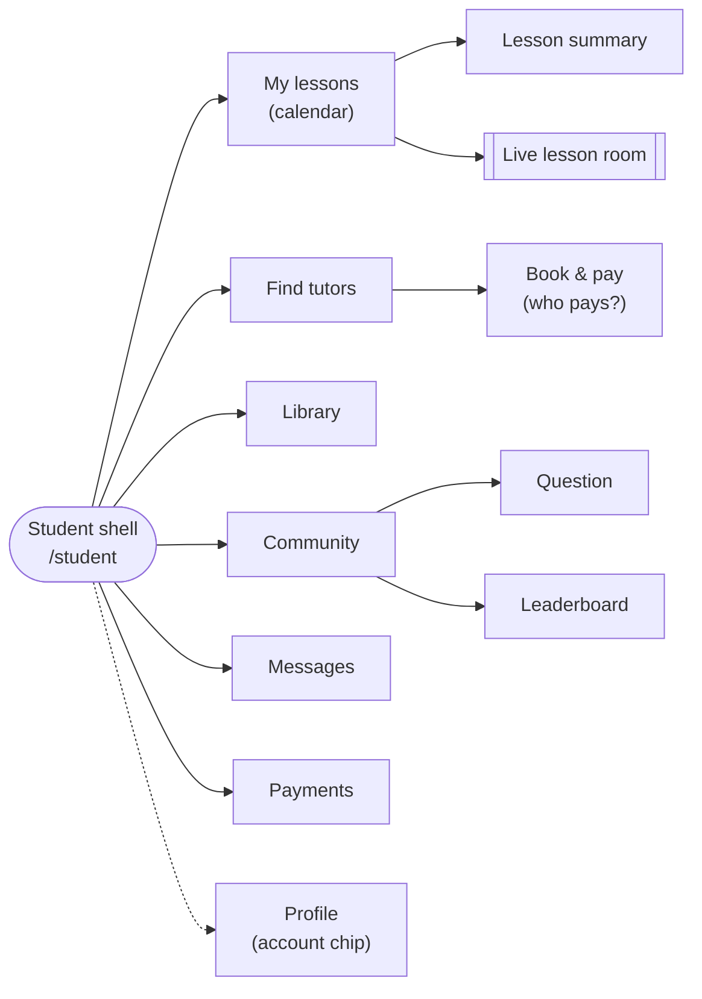

**Parent**

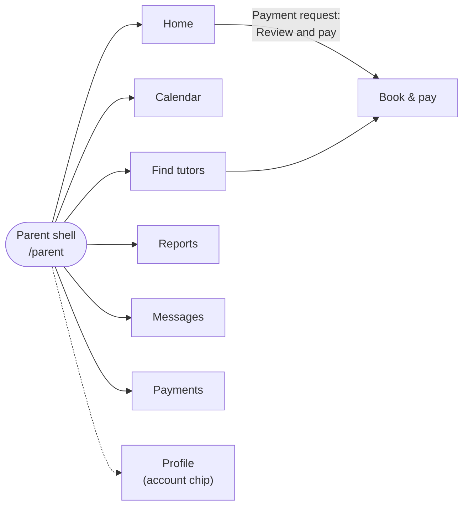

When a student picks **"Ask parent to pay"** on their Book & pay page, the request appears on Parent · Home.

**Tutor**

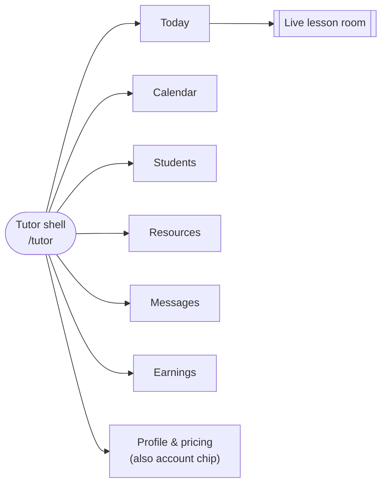

### 4.3 Navigation config (single source of truth)

```ts
// src/config/nav.ts
import { Video, Search, BookOpen, Users, MessageSquare, CreditCard, Home, Calendar,
         FileText, Clock, Folder, Wallet, User, type LucideIcon } from "lucide-react";

export type Role = "student" | "parent" | "tutor";
export type NavItem = { label: string; href: string; icon: LucideIcon; match?: string[] };

export const NAV: Record<Role, NavItem[]> = {
  student: [
    { label: "My lessons",  href: "/student/lessons",   icon: Video },
    { label: "Find tutors", href: "/student/tutors",    icon: Search },
    { label: "Library",     href: "/student/library",   icon: BookOpen },
    { label: "Community",   href: "/student/community", icon: Users },
    { label: "Messages",    href: "/student/messages",  icon: MessageSquare },
    { label: "Payments",    href: "/student/payments",  icon: CreditCard },
  ],
  parent: [
    { label: "Home",        href: "/parent",            icon: Home, match: ["/parent"] },
    { label: "Calendar",    href: "/parent/calendar",   icon: Calendar },
    { label: "Find tutors", href: "/parent/tutors",     icon: Search },
    { label: "Reports",     href: "/parent/reports",    icon: FileText },
    { label: "Messages",    href: "/parent/messages",   icon: MessageSquare },
    { label: "Payments",    href: "/parent/payments",   icon: CreditCard },
  ],
  tutor: [
    { label: "Today",             href: "/tutor",           icon: Clock, match: ["/tutor"] },
    { label: "Calendar",          href: "/tutor/calendar",  icon: Calendar },
    { label: "Students",          href: "/tutor/students",  icon: Users },
    { label: "Resources",         href: "/tutor/resources", icon: Folder },
    { label: "Messages",          href: "/tutor/messages",  icon: MessageSquare },
    { label: "Earnings",          href: "/tutor/earnings",  icon: Wallet },
    { label: "Profile & pricing", href: "/tutor/profile",   icon: User },
  ],
};

export const PROFILE_HREF: Record<Role, string> = {
  student: "/student/profile", parent: "/parent/profile", tutor: "/tutor/profile",
};
export const ROLE_LABEL: Record<Role, string> = { student: "STUDENT", parent: "PARENT", tutor: "TUTOR" };
```

**Active-item rule:** an item is active when the pathname starts with its `href`. The exceptions are
items with `match`: role home pages such as `/parent` and `/tutor` are active only on an exact match.
Sub-pages highlight their parent item, so `/student/community/leaderboard` highlights **Community**
and `/parent/tutors/123/book` highlights **Find tutors**.

### 4.4 Back links

Sub-pages show a back link above the title: 14/600, `--primary`, no underline, for example
"← Back to tutors", "← Back to my lessons" or "← Back to community".

---

## 5. Roles and permissions

These rules change what the UI shows. Implement them as small helper functions in
`src/lib/permissions.ts`, not as scattered `if`s.

| Capability | Student (secondary, permitted) | Student (primary) | Parent | Tutor |
| --- | --- | --- | --- | --- |
| Find tutors | ✅ (if the parent allowed it) | ❌ menu item hidden | ✅ | — |
| Pay with own card | ✅ (if allowed) | ❌ | ✅ | — |
| Ask parent to pay | ✅ (only if a parent is linked) | — | Receives requests | — |
| See child's messages with tutors | — | — | ✅ **always** for under-18s (locked switch) | — |
| Join a lesson | ✅ | ✅ (PIN login set by parent) | ❌ | ✅ |
| Write after-class report | — | — | — | ✅ |
| Community | ✅ | ✅ | — | ✅ (answers and verifies) |
| Manage child permissions | — | — | ✅ in Parent · Profile | — |

```ts
// src/lib/permissions.ts
export const canBook = (s: Student) => s.permissions.canBook;
export const canPayOwnCard = (s: Student) => s.permissions.canPayOwnCard && s.learningProfile.level !== "primary";
export const canAskParentToPay = (s: Student) => !!s.linkedParentId && s.permissions.canRequestParentPayment;
export const parentSeesMessages = (s: Student) => s.isUnder18 || s.permissions.parentSeesMessages;
```

When a student can't book (for example Lesego), hide **Find tutors** from the sidebar. Their
"+ Book a lesson" buttons become "Ask a parent to book", which sends a request.

---

## 6. Route map and screen index

### 6.1 Routes

| Route | Screen | Layout |
| --- | --- | --- |
| `/lesson/[lessonId]` | Live lesson (desktop and phone are one responsive page) | Full screen, dark, no sidebar |
| `/student/lessons` | My lessons (calendar) | Student shell |
| `/student/lessons/[lessonId]` | Lesson summary | Student shell |
| `/student/tutors` | Find tutors | Student shell |
| `/student/tutors/[tutorId]/book` | Book & pay (who pays?) | Student shell |
| `/student/library` | Library | Student shell |
| `/student/community` | Community feed | Student shell |
| `/student/community/[questionId]` | Question and answers | Student shell |
| `/student/community/leaderboard` | Leaderboard | Student shell |
| `/student/messages` | Messages | Student shell |
| `/student/payments` | Payments | Student shell |
| `/student/profile` | Profile | Student shell |
| `/parent` | Home | Parent shell |
| `/parent/calendar` | Calendar | Parent shell |
| `/parent/tutors` | Find tutors | Parent shell |
| `/parent/tutors/[tutorId]/book` | Book & pay | Parent shell |
| `/parent/reports` | Reports | Parent shell |
| `/parent/messages` | Messages | Parent shell |
| `/parent/payments` | Payments | Parent shell |
| `/parent/profile` | Profile | Parent shell |
| `/tutor` | Today | Tutor shell |
| `/tutor/calendar` | Calendar & availability | Tutor shell |
| `/tutor/students` | Students | Tutor shell |
| `/tutor/resources` | Resources | Tutor shell |
| `/tutor/messages` | Messages | Tutor shell |
| `/tutor/earnings` | Earnings | Tutor shell |
| `/tutor/profile` | Profile & pricing | Tutor shell |

Use query parameters for selected state, so links can be shared and the back button works:

| Parameter | Used on |
| --- | --- |
| `?date=2026-10-22` | Calendars |
| `?child=neo` | Parent pages |
| `?level=secondary&system=national&curriculum=bgcse&subject=mathematics` | Find tutors |
| `?thread=…` | Messages |
| `?tab=past-papers` | Library and Resources tabs |
| `?student=…` | Tutor · Students |

### 6.2 Screen index and screenshot filenames

Export each canvas board as a PNG to `docs/design/screens/<file>`.

| # | Role | Screen | Canvas board title | Screenshot file | Interactive in design |
| --- | --- | --- | --- | --- | --- |
| 1 | Shared | Live lesson (desktop) | Live lesson · desktop (video + whiteboard) | `lesson-room-desktop.png` | ✅ |
| 2 | Shared | Live lesson (phone) | Live lesson · phone | `lesson-room-phone.png` | |
| 3 | Student | My lessons | Student · My lessons (calendar) | `student-my-lessons.png` | ✅ |
| 4 | Student | Lesson summary | Student · Lesson summary | `student-lesson-summary.png` | |
| 5 | Student | Find tutors | Student · Find tutors (new filters) | `student-find-tutors.png` | ✅ |
| 6 | Student | Book & pay | Student · Book & pay (who pays?) | `student-book-pay.png` | |
| 7 | Student | Library | Student · Library | `student-library.png` | |
| 8 | Student | Community feed | Student · Community feed | `student-community.png` | |
| 9 | Student | Question | Student · Community question | `student-question.png` | |
| 10 | Student | Leaderboard | Student · Community leaderboard | `student-leaderboard.png` | |
| 11 | Student | Messages | Student · Messages | `student-messages.png` | |
| 12 | Student | Payments | Student · Payments | `student-payments.png` | |
| 13 | Student | Profile | Student · Profile | `student-profile.png` | |
| 14 | Parent | Home | Parent · Home | `parent-home.png` | |
| 15 | Parent | Calendar | Parent · Calendar | `parent-calendar.png` | ✅ |
| 16 | Parent | Find tutors | Parent · Find tutors (new filters) | `parent-find-tutors.png` | ✅ |
| 17 | Parent | Book & pay | Parent · Book & pay | `parent-book-pay.png` | |
| 18 | Parent | Reports | Parent · Reports | `parent-reports.png` | |
| 19 | Parent | Messages | Parent · Messages | `parent-messages.png` | |
| 20 | Parent | Payments | Parent · Payments | `parent-payments.png` | |
| 21 | Parent | Profile | Parent · Profile | `parent-profile.png` | |
| 22 | Tutor | Today | Tutor · Today | `tutor-today.png` | |
| 23 | Tutor | Calendar | Tutor · Calendar | `tutor-calendar.png` | |
| 24 | Tutor | Students | Tutor · Students | `tutor-students.png` | |
| 25 | Tutor | Resources | Tutor · Resources | `tutor-resources.png` | |
| 26 | Tutor | Messages | Tutor · Messages | `tutor-messages.png` | |
| 27 | Tutor | Earnings | Tutor · Earnings | `tutor-earnings.png` | |
| 28 | Tutor | Profile & pricing | Tutor · Profile & pricing | `tutor-profile.png` | ✅ |

---

## 7. Screen specifications

Each screen lists its **purpose**, **layout**, **content and components**, **interactions** and
**states**. Sample copy is in quotes. Use it as written unless it's a placeholder.

### Common states for every page

| State | Behaviour |
| --- | --- |
| **Loading** | Skeletons that match the final layout: grey `--divider-soft` blocks with the same radius. Never a full-page spinner. |
| **Empty** | `EmptyState` component: a short headline, one sentence and one action, inside a dashed `--input` border card. Example: "No lessons on this day." |
| **Error** | Inline card with "Something went wrong" and [Try again]. Toast for failed actions. |
| **Success** | Toast via sonner, e.g. "Report sent to Masego", "Lesson booked". |

---

### 7.1 Live lesson room — `/lesson/[lessonId]`

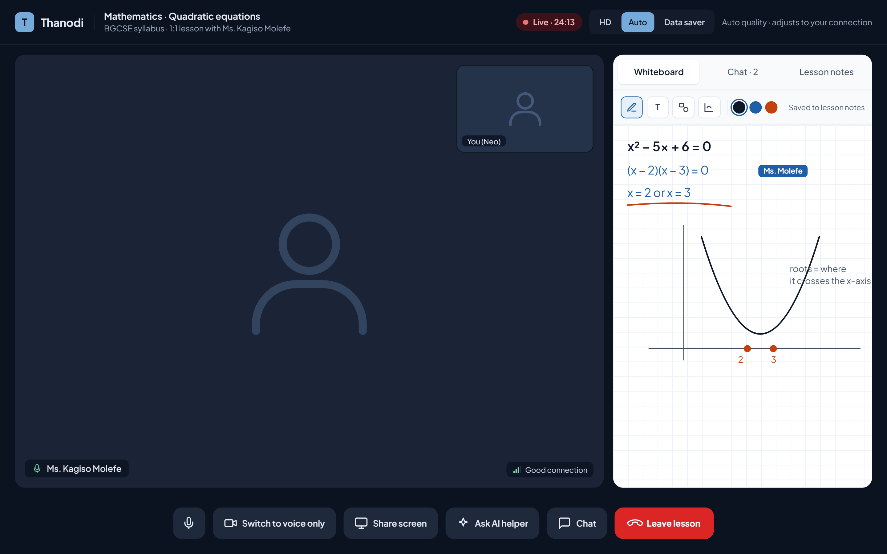
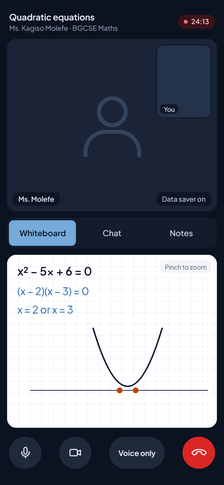

**Purpose:** a one-to-one video lesson with a shared whiteboard. This is the heart of the product, so
it must feel fast, clear and calm.

**Who:** the student and the tutor. Parents cannot join.

**Desktop layout** (dark, `--room-bg`, no sidebar):

```
┌──────────────────────────────────────────────────────────────────────────────────────┐
│ [T] Thanodi │ Mathematics · Quadratic equations           (● Live · 24:13)            │
│             │ BGCSE syllabus · 1:1 lesson with Ms. Kagiso   [HD|Auto|Data saver]      │
│             │ Molefe                                        Auto quality · adjusts…   │
├──────────────────────────────────────────────┬───────────────────────────────────────┤
│ ▒▒▒▒▒▒▒▒▒▒▒▒▒▒▒▒▒▒▒▒▒▒▒▒▒▒▒▒▒ ┌──────────┐   │ [Whiteboard] [Chat · 2] [Lesson notes]│
│ ▒▒▒▒▒▒▒ REMOTE VIDEO ▒▒▒▒▒▒▒▒ │ SELF VIEW│   │ ✎ T ◻ 📈 │ ● ● ●   Saved to notes │
│ ▒▒▒▒▒▒▒ (tutor or student) ▒▒ │ You (Neo)│   │ ┌───────────────────────────────────┐ │
│ ▒▒▒▒▒▒▒▒▒▒▒▒▒▒▒▒▒▒▒▒▒▒▒▒▒▒▒▒▒ └──────────┘   │ │  grid-paper whiteboard (Excalidraw)│ │
│ ▒▒▒▒▒▒▒▒▒▒▒▒▒▒▒▒▒▒▒▒▒▒▒▒▒▒▒▒▒▒▒▒▒▒▒▒▒▒▒▒▒▒   │ │  x² − 5x + 6 = 0 …                 │ │
│ [🎤 Ms. Kagiso Molefe]      [▮▮▮ Good connection]│ └───────────────────────────────────┘ │
├──────────────────────────────────────────────┴───────────────────────────────────────┤
│   [🎤]  [📹 Switch to voice only]  [Share screen]  [✨ Ask AI helper]  [Chat]  [Leave]│
└──────────────────────────────────────────────────────────────────────────────────────┘
   video column: flex 999 1 560px, min-height 560     tools column: flex 1 1 420px, light
```

**Component tree:**

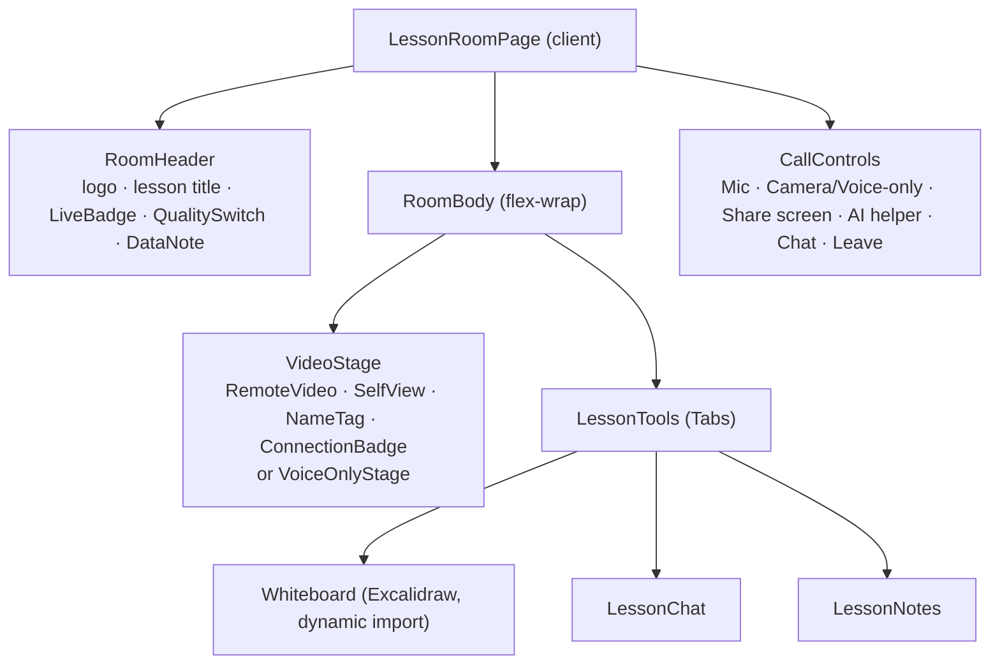

**Header:**
- Logo, a vertical divider, then the lesson title "Mathematics · Quadratic equations" (15/600) and a
  subline "BGCSE syllabus · 1:1 lesson with Ms. Kagiso Molefe" (13px `--room-muted`).
- On the right:
  - `LiveBadge`, a pill with the `live` colours, a dot and the elapsed time "Live · 24:13".
  - `QualitySwitch`, a segmented control **HD | Auto | Data saver** on a `--room-panel` track. The
    active item has a `--brand-sky` background and dark text.
  - A data note that changes with the selection:

    | Selection | Note |
    | --- | --- |
    | HD | "HD video · est. 1.2 GB per hour" |
    | Auto (default) | "Auto quality · adjusts to your connection" |
    | Data saver | "Data saver · est. 300 MB per hour" |
    | Voice only | "Voice only · est. 40 MB per hour" |

    These figures are **estimates** and live in a config constant.

**Video stage (video mode):**
- The remote participant fills the area. Use a placeholder silhouette until Stream is wired up.
- **Self view:** a 220×140 tile in the top-right corner with a 2px `--room-bg` border, labelled "You (Neo)".
- **Bottom-left name tag:** a mic icon in `--room-good` and the name, on `rgba(11,18,32,0.8)`.
- **Bottom-right connection badge:** a signal icon and "Good connection" (or "Fair connection" in `--room-fair`).

**Voice-only stage** (shown when "Switch to voice only" is on):
- Two 140px avatar circles with initials. The person speaking has a 4px `--room-good` ring and the
  label "Speaking"; the other shows "Listening".
- Text below: **"Voice-only mode"** and "Video is paused to save data. The whiteboard and chat keep
  working. Turn your camera back on any time."
- Switching to voice only also shows the quality data note "Voice only · est. 40 MB per hour".
- Choosing any quality option turns video back on.

**Tools column** (light, `--card`, radius 16px):
- Tabs: **Whiteboard**, **Chat · 2** (unread count), **Lesson notes**.
- Whiteboard toolbar: pen (selected), text, shapes, graph paper, a divider, three ink colours
  (`#0F172A`, `#1D5FA8`, `#C2410C`) and, on the right, "Saved to lesson notes" in muted text.
- The canvas has a grid-paper background (24px grid of `#EEF2F7` lines) and shows a cursor label
  ("Ms. Molefe") where the other person is drawing.
- Implement with Excalidraw: hide its default UI chrome where possible and map these tools onto it.
  Load it with `dynamic(() => import(...), { ssr: false })`.

**Call controls (bottom, centred, wrapping):**

| Control | Look | Behaviour |
| --- | --- | --- |
| Mic | 52×52 square | `aria-label` "Mute microphone" / "Unmute microphone". Muted = `--destructive` background. |
| Camera | 52px tall, with label | "Switch to voice only" ⇄ "Turn camera on". In voice-only mode the background is `--brand-sky`. |
| Share screen | 52px tall | Starts screen sharing |
| Ask AI helper | 52px tall | Opens a side sheet with the study helper (section 7.6) |
| Chat | 52px tall | Switches the tools tab to Chat |
| Leave lesson | Destructive, 52px tall | Opens a confirm dialog, then goes to the role's lesson page. For the tutor it goes to the after-class report. |

**Phone layout (< 640px)**, top to bottom:

```
┌──────────────────────────────┐
│ Quadratic equations  (● 24:13)│
│ Ms. Kagiso Molefe · BGCSE …  │
│ ┌──────────────────────────┐ │
│ │▒▒▒▒ remote video ▒ ┌───┐ │ │  300px tall
│ │▒▒▒▒▒▒▒▒▒▒▒▒▒▒▒▒▒▒▒ │You│ │ │  self view 96×128
│ │[Ms. Molefe] [Data saver on]│ │
│ └──────────────────────────┘ │
│ [Whiteboard][Chat][Notes]    │  44px tabs on --room-panel
│ ┌──────────────────────────┐ │
│ │ whiteboard (pinch zoom)  │ │  fills remaining height
│ └──────────────────────────┘ │
│  (🎤)  (📹)  [Voice only] (⏻)│  56px round buttons
└──────────────────────────────┘
```

**Rules:**
- The **Join** button elsewhere in the app opens **10 minutes** before the start time. Before that it
  is disabled with the text "Opens at 16:50".
- Default quality is **Auto**. Remember the user's last choice from their profile preference.
- No recording. Live 1:1 sessions are **not recorded**, which matters for app-store payment rules.

---

### 7.2 Student · My lessons — `/student/lessons`


**Purpose:** see the next lesson, every lesson in a month calendar, and jump to summaries.

```
┌─────────────────────────────────────────────────────────────────────────────┐
│ My lessons                                                                  │
│ ┌─────────────────────────────── navy hero ──────────────────────────────┐  │
│ │ NEXT LESSON · STARTS IN 1 H 52 MIN          ┌── Check your setup ─────┐│  │
│ │ Quadratics, part 2                          │ Camera        Working   ││  │
│ │ Today, 17:00–18:00 · Ms. Kagiso Molefe · …  │ Microphone    Working   ││  │
│ │ Your goal: “Factorising quadratics …”       │ Connection  Fair · Auto ││  │
│ │ [Join video lesson] [Reschedule]            └─────────────────────────┘│  │
│ │ The join button opens 10 minutes before the lesson.                    │  │
│ └────────────────────────────────────────────────────────────────────────┘  │
│ ┌────────── Calendar (flex 3) ───────────────┐ ┌── Side (flex 2) ────────┐  │
│ │ ‹ October ›                [+ Book a lesson]│ │ TODAY                   │  │
│ │ ■Maths ■Physics □Done ■Missed ┊Waiting pay │ │ Wednesday 22 October    │  │
│ │ Mon Tue Wed Thu Fri Sat Sun                 │ │ ▌15:00 · Quadratics, p1 │  │
│ │ 29  30   1   2   3   4   5                  │ │ ▌Maths · Ms. Molefe     │  │
│ │              …  10:00 Physics               │ │ ▌(Done)   View summary  │  │
│ │ …  ⓶② 22 [15:00 Maths][17:00 Maths] …      │ │ ▌17:00 · Quadratics, p2 │  │
│ │                                             │ │ ▌(Starts in 1h52)  Join │  │
│ └─────────────────────────────────────────────┘ ├─────────────────────────┤  │
│                                                 │ Upcoming (4)            │  │
│                                                 ├─────────────────────────┤  │
│                                                 │ Past lessons (3)        │  │
│                                                 └─────────────────────────┘  │
└─────────────────────────────────────────────────────────────────────────────┘
```

**Next-lesson hero** (`NextLessonHero`, navy, radius 20px):
- An eyebrow countdown that updates every minute: "NEXT LESSON · STARTS IN 1 H 52 MIN" (or "· LIVE NOW").
- The title, the time and tutor line, and "Your goal: “…”", taken from the booking's "What do you want to cover?".
- Buttons: **Join video lesson** (accent-on-navy, video icon, disabled until 10 minutes before) and
  **Reschedule** (outline-on-navy, opens a dialog to pick another slot from the tutor's availability).
- **Check your setup** box (`--navy-raised`): Camera, Microphone and Connection, each with a status
  ("Working" in green `#7DD3A8`, "Fair · Auto quality" in amber `#F2C14E`). It checks devices with
  `navigator.mediaDevices`. Only request permission when the user opens this check; show "Check" until then.

**Month calendar** (`MonthCalendar`, client component):
- Header: ‹ month › and **+ Book a lesson** (links to Find tutors).
- Legend: Maths (solid `--cat-1`), Physics (solid `--cat-2`), Done (grey fill with border), Missed
  (`--status-danger-bg`), Waiting for payment (dashed `--pending-dashed`).
- Grid: 7 columns starting on **Monday**, with leading and trailing days from adjacent months in
  `--text-faint`. Cells are at least 104px tall with 1px `--border` gaps. The grid is horizontally
  scrollable on small screens (min-width 560px).
- Today's date number sits in a filled `--primary` circle with white text.
- The selected cell gets an inset 2px `--primary` ring and a `#F0F6FD` background.
- **Lesson chips** inside a cell: "15:00 Maths", 11px/600, radius 6px, ellipsis. The style depends on status:

  | Status | Chip style |
  | --- | --- |
  | Upcoming / booked / next | Subject light background, 3px left border in the subject colour, dark text |
  | Done | `--divider-soft` background, muted text, 3px left border in the subject colour |
  | Missed | `--status-danger-bg`, `--status-danger-fg`, line-through |
  | Waiting for payment | White background, 1px dashed `--pending-dashed` border, `--status-warning-fg` text |

- Each cell is a `<button>` with an aria-label like "Wednesday 22 October, 2 lessons". Clicking it
  selects the day and updates `?date=`.

**Side column:**
1. **Day panel** (2px `--primary` border):
   - Eyebrow "TODAY" or "SELECTED DAY", then the full date "Wednesday 22 October".
   - Each lesson shows a colour bar, "17:00 · Quadratics, part 2", "Maths · Ms. Kagiso Molefe", a status
     pill and one action link:

     | Status | Pill | Action |
     | --- | --- | --- |
     | Done | "Done" (success) | **View summary** → `/student/lessons/[id]` |
     | Next | "Starts in 1 h 52 min" (info) | **Join** → `/lesson/[id]` |
     | Upcoming | "Booked · paid" (info) | **Message tutor** |
     | Missed | "Missed" (danger) | **Rebook** → Find tutors with that tutor's filters |
     | Waiting for payment | "Waiting for Masego to pay" (warning) | **View payment** → `/student/payments` |

   - Empty day: "No lessons on this day."
2. **Upcoming:** the next 4 lessons, each with a date tile (weekday over day number on `--accent`),
   title and a meta line, e.g. "16:00 · Maths · Ms. Kagiso Molefe".
3. **Past lessons:** the last 3, each with title, meta and a **View summary** link.

**Mock data for October** (dates → lessons):

| Date | Lessons |
| --- | --- |
| 4 | Physics |
| 6 | Maths |
| 8 | Maths |
| 11 | Physics |
| 13 | Maths |
| 15 | Maths (**missed**) |
| 18 | Physics |
| 20 | Maths |
| 22 | Maths 15:00 done; Maths 17:00 next |
| 24 | Maths |
| 25 | Physics |
| 28 | Maths |
| 1 Nov | Physics (**waiting for payment**) |

---

### 7.3 Student · Lesson summary — `/student/lessons/[lessonId]`

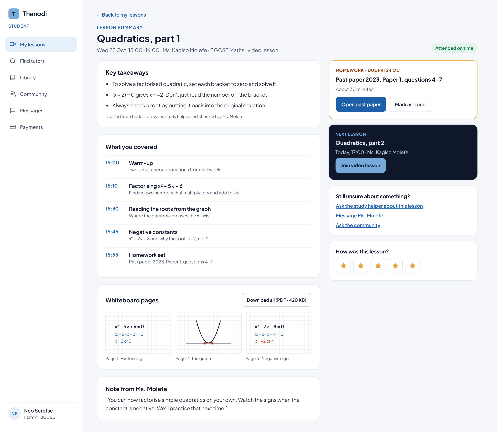

**Purpose:** what happened in a class, what to do next. It is produced from the tutor's after-class
report (section 8.3).

**Layout:** "← Back to my lessons", then a header with eyebrow "LESSON SUMMARY", the title
"Quadratics, part 1", the meta "Wed 22 Oct, 15:00–16:00 · Ms. Kagiso Molefe · BGCSE Maths · video
lesson" and an attendance pill on the right ("Attended on time").

**Main column (flex 3), in order:**
1. **Key takeaways:** 3 bullets. Caption: "Drafted from the lesson by the study helper and checked by
   Ms. Molefe." Show this caption only if `aiDrafted && tutorApproved`. If the tutor wrote the
   takeaways, show no caption.
2. **What you covered:** a timeline of rows, each with a time in `--primary` and a title and detail.
   Example rows: 15:00 Warm-up · 15:10 Factorising x² − 5x + 6 · 15:30 Reading roots from the graph ·
   15:45 Negative constants · 15:55 Homework set.
3. **Whiteboard pages:** a 3-column grid of thumbnails on grid paper, each captioned ("Page 1 ·
   Factorising"), plus **Download all (PDF · 420 KB)**.
4. **Note from Ms. Molefe:** the tutor's comment as a quote.

**Side column (flex 2):**
1. **Homework card** (2px `--highlight-border`):
   - Eyebrow "HOMEWORK · DUE FRI 24 OCT", the task, and "About 30 minutes".
   - Buttons: **Open past paper** (links to the Library) and **Mark as done**, which switches to a
     success pill "Homework done".
2. **Next lesson** (navy): title, time and **Join video lesson**.
3. **Still unsure about something?** Three links: "Ask the study helper about this lesson", "Message
   Ms. Molefe" and "Ask the community".
4. **How was this lesson?** Five 44×44 star buttons, with aria-labels "Rate 1 out of 5" and so on.

---

### 7.4 Find tutors (student and parent) — `/student/tutors`, `/parent/tutors`

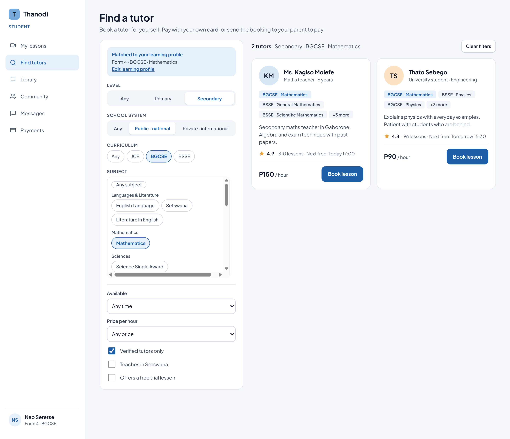
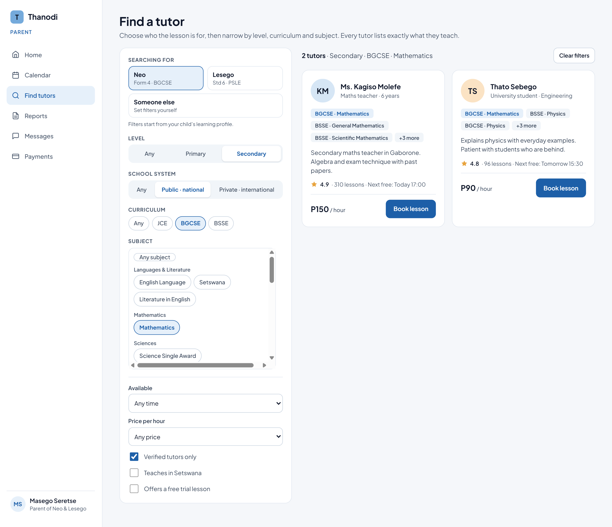

**Purpose:** find a tutor by curriculum and subject. The same page and component serve both roles;
only the context block at the top of the filters differs.

```
┌──────────── Filters (flex 1, ≥320px) ────────┐ ┌──────────── Results (flex 3) ──────────────────┐
│ CONTEXT BLOCK (role-specific, see below)     │ │ 2 tutors · Secondary · BGCSE · Mathematics      │
│ LEVEL         [Any|Primary|Secondary]        │ │                                [Clear filters] │
│ SCHOOL SYSTEM [Any|Public · national|        │ │ ┌──────────────┐ ┌──────────────┐               │
│                Private · international]      │ │ │(KM) Ms. Kagiso│ │(TS) Thato    │               │
│ CURRICULUM    (Any)(JCE)(BGCSE)(BSSE)        │ │ │Maths teacher… │ │University …  │               │
│ SUBJECT ┌──────────────────────────────────┐ │ │ │[BGCSE·Maths]  │ │[BGCSE·Maths] │  matched tag  │
│         │ (Any subject)                    │ │ │ │[BSSE·Gen…][+3]│ │…             │  first, info  │
│         │ Languages & Literature           │ │ │ │bio…           │ │bio…          │               │
│         │ (English Language)(Setswana)…    │ │ │ │★4.9·310·Next… │ │★4.8 …        │               │
│         │ Mathematics  (Mathematics)       │ │ │ │P150/hour [Book]│ │P90/hour [Book]│              │
│         │ Sciences (Chemistry)(Physics)…   │ │ │ └──────────────┘ └──────────────┘               │
│         └──────── scroll, max 260px ───────┘ │ └────────────────────────────────────────────────┘
│ ───────────────                              │
│ Available [▾ Any time]   Price [▾ Any price] │
│ [x] Verified tutors only                     │
│ [ ] Teaches in Setswana                      │
│ [ ] Offers a free trial lesson               │
└──────────────────────────────────────────────┘
```

**Context block:**

- **Parent: "SEARCHING FOR".** Three tiles:

  | Tile | Subline |
  | --- | --- |
  | Neo | Form 4 · BGCSE |
  | Lesego | Std 6 · PSLE |
  | Someone else | Set filters yourself |

  Picking a child fills the filters from that child's learning profile:
  - Neo → secondary / national / BGCSE / Mathematics (his first goal subject)
  - Lesego → primary / national / PSLE / any

  Caption: "Filters start from your child’s learning profile." Changing any filter manually switches
  the tile to "Someone else".
- **Student: an `--accent` box.**
  - While the filters equal their profile: "Matched to your learning profile" and "Form 4 · BGCSE · Mathematics".
  - After a manual change: "Custom search" and a **Back to my profile** button.
  - Always: an **Edit learning profile** link.

**Filter cascade:** the logic must match exactly. See the diagram in section 8.5.

| Control | Options | Behaviour |
| --- | --- | --- |
| Level | Any, Primary, Secondary | Segmented control |
| School system | Any, national, international | Labels when Level = Secondary: "Public · national" / "Private · international". Otherwise: "Botswana national" / "International". |
| Curriculum | "Any" plus the curricula matching the level and system | Chips, in the order of `CURRICULA` |
| Subject | "Any subject" plus the chosen curriculum's subjects, grouped by category | Shown only when a curriculum is chosen. Otherwise show "Choose a curriculum to pick a subject." |

**Reset rules:**
- If a level or system change makes the selected curriculum invalid, reset curriculum and subject to "any".
- Changing the curriculum resets the subject to "any".

**Matching rule:** a tutor is shown if **any** of their offerings matches. An offering
`{curriculumId, subjectId}` matches when all of the following hold:
- The level and system of its curriculum fit the filter (or the filter is Any).
- The curriculum equals the filter (or the filter is Any).
- The subject equals the filter, or the filter is Any, or the offering is `entireCurriculum`.

**Tutor card** (`TutorCard`):
- A 56px avatar with initials on a tint, the name (16/700) and the headline (13px muted).
- Up to 3 tags, with **matching offerings first** in info colours, the rest neutral, then "+N more".
- Tag text format: "BGCSE · Mathematics", or "PSLE · Entire curriculum".
- The bio, then a meta row: ★ rating (bold), "· 310 lessons · Next free: Today 17:00".
- Footer, divided by a top border: the price "P150 / hour" (18/700) and a **Book lesson** button
  linking to `…/tutors/[tutorId]/book`.

**Results header:** "**2 tutors** · Secondary · BGCSE · Mathematics" (or "All subjects"), plus a
**Clear filters** button that sets everything to Any.

**Empty results:** "No tutors match yet. Try “Any subject”, or ask the community while we find one."

The other filters (availability, price, verified, Setswana, free trial) are UI-only in v1. Wire them
into the mock filter function if it's easy.

---

### 7.5 Book & pay — `/parent/tutors/[id]/book`, `/student/tutors/[id]/book`

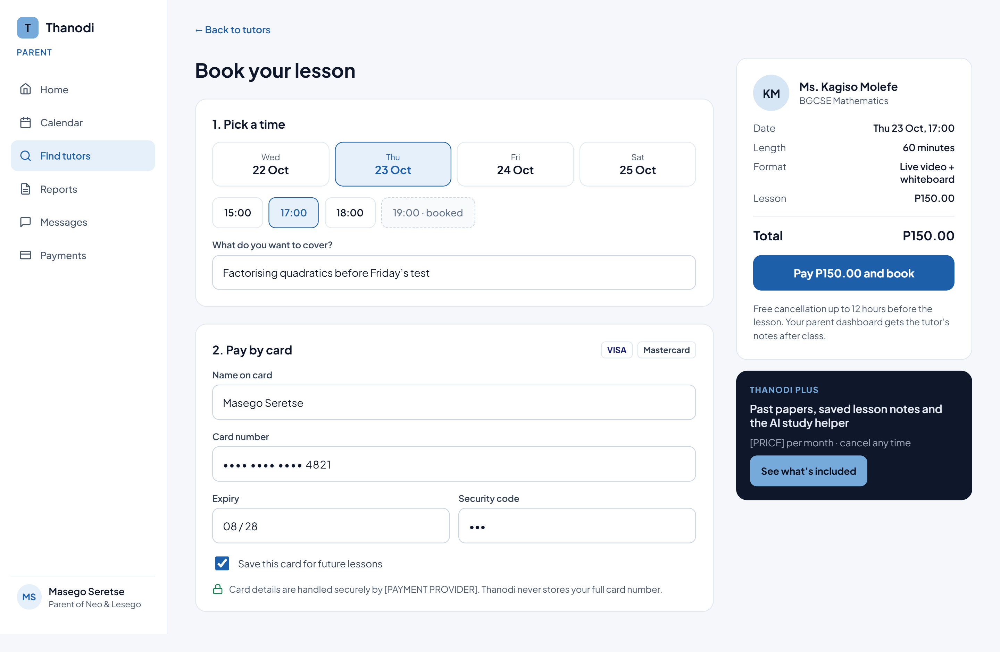
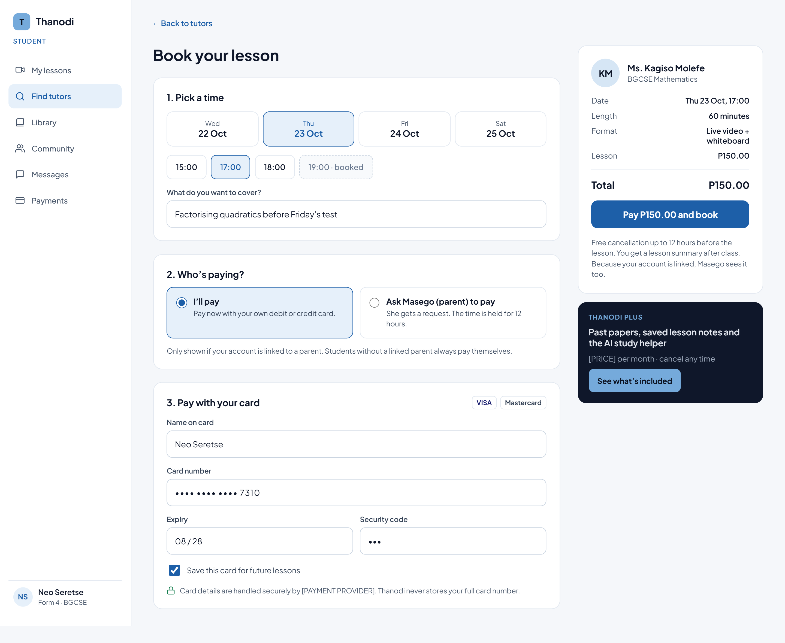

**Layout:** "← Back to tutors", the title "Book your lesson", a left column of numbered step cards
and a right column with the order summary.

**Step 1: Pick a time.**
- A row of 4+ date buttons (64px tall, showing the weekday and "23 Oct"). The selected one has a 2px
  `--primary` border and `--accent` background.
- A row of time-slot buttons: "15:00", "17:00", "18:00". A taken slot is disabled with a dashed
  border and the text "19:00 · booked".
- The input **"What do you want to cover?"**, e.g. "Factorising quadratics before Friday’s test".
  It becomes the "Your goal" line on My lessons.

**Step 2, student only: "Who’s paying?"** Two tile radios:

| Tile | Title | Description |
| --- | --- | --- |
| Default | **I’ll pay** | "Pay now with your own debit or credit card." |
| Second | **Ask Masego (parent) to pay** | "She gets a request. The time is held for 12 hours." |

- Caption: "Only shown if your account is linked to a parent. Students without a linked parent always
  pay themselves."
- Use the permission helpers to show or hide this step.
- If "Ask parent" is chosen, hide the card step and change the primary button to **Send request to
  Masego**. On success, toast "Request sent. We’ll hold this time for 12 hours." and create a
  lesson with `awaiting_payment`.

**Step 2 for parents (step 3 for students): Pay with your card.**
- Visa and Mastercard badges.
- Fields: Name on card, Card number, Expiry, Security code, and the checkbox "Save this card for
  future lessons".
- Secure note with a lock icon: "Card details are handled securely by `[PAYMENT PROVIDER]`. Thanodi
  never stores your full card number."
- **Important:** build this as a `CardForm` component with a clear interface. The real fields will be
  the payment provider's hosted fields or iframe, so do not build real card handling. Mock submit
  returns success after 800ms.

**Order summary (right):**
- The tutor's avatar, name and subject.
- A definition list: Date "Thu 23 Oct, 17:00", Length "60 minutes", Format "Live video + whiteboard",
  Lesson "P150.00".
- A divider, then **Total P150.00**.
- The primary button **Pay P150.00 and book**, full width, 52px.
- Policy text:
  - Parent: "Free cancellation up to 12 hours before the lesson. Your parent dashboard gets the
    tutor’s notes after class."
  - Student: "…You get a lesson summary after class. Because your account is linked, Masego sees it too."

**Thanodi Plus upsell** (navy card): "THANODI PLUS", "Past papers, saved lesson notes and the AI study
helper", "`[PRICE]` per month · cancel any time" and a **See what’s included** link to Payments.

**After a successful payment:** toast "Lesson booked", then redirect to the role's calendar with the
new lesson selected.

---

### 7.6 Student · Library — `/student/library`

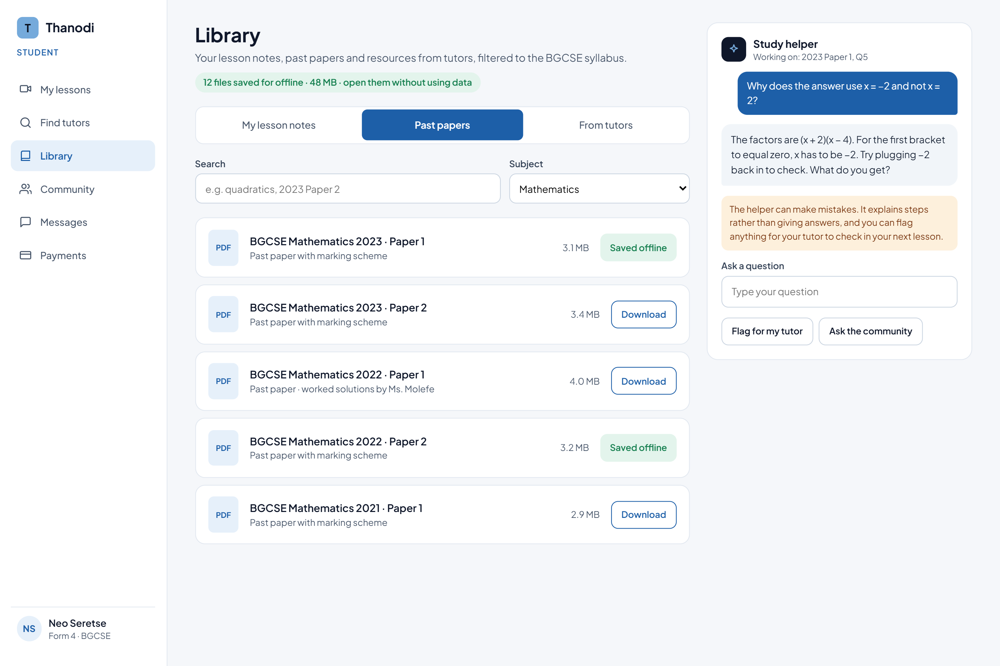

**Main column:**
- The title, the subtitle "Your lesson notes, past papers and resources from tutors, filtered to the
  BGCSE syllabus." and a success pill "12 files saved for offline · 48 MB · open them without using data".
- Tabs: **My lesson notes**, **Past papers** (default in the design) and **From tutors**.
- A **Search** input (placeholder "e.g. quadratics, 2023 Paper 2") and a **Subject** select, defaulting
  to the student's subjects.
- A file list. Each row has a type tile ("PDF", on `--accent`), a title such as "BGCSE Mathematics
  2023 · Paper 1", meta such as "Past paper with marking scheme", a size and an action:

  | State | Action | Look |
  | --- | --- | --- |
  | Not downloaded | **Download** | Outline primary |
  | Saved | **Saved offline** | Success fill |

  Offline saving uses the Cache API through a service worker later. In v1 it just toggles the state.

**Side column: AI study helper panel.**
- Header: a navy icon tile with sparkles, "Study helper" and "Working on: 2023 Paper 1, Q5".
- Chat bubbles: the student's on the right in `--primary`, the helper's on the left in `--divider-soft`.
- A warning box in warning colours: "The helper can make mistakes. It explains steps rather than
  giving answers, and you can flag anything for your tutor to check in your next lesson."
- An **Ask a question** input and the buttons **Flag for my tutor** and **Ask the community**.
- The AI is mocked with canned replies in v1.

---

### 7.7 Student · Community — `/student/community`

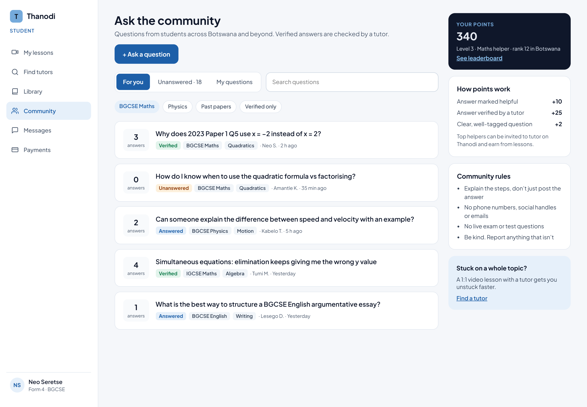

**Main column:**
- The title "Ask the community", the subtitle "Questions from students across Botswana and beyond.
  Verified answers are checked by a tutor." and the CTA **+ Ask a question**, which opens a dialog
  (see below).
- Tabs **For you · Unanswered · 18 · My questions**, with a search input.
- Tag filter chips: "BGCSE Maths" (on), "Physics", "Past papers", "Verified only".
- Question list. Each item is a link card:
  - An answers count tile ("3" over "answers").
  - The title (16/600).
  - A row with a status pill, curriculum and topic tags, and "· Neo S. · 2 h ago".

  | Status | Pill colours |
  | --- | --- |
  | Verified | success |
  | Answered | info |
  | Unanswered | warning |

**Side column:**
1. **Your points** (navy): "340", "Level 3 · Maths helper · rank 12 in Botswana" and a **See
   leaderboard** link.
2. **How points work:**

   | Action | Points |
   | --- | --- |
   | Answer marked helpful | +10 |
   | Answer verified by a tutor | +25 |
   | Clear, well-tagged question | +2 |

   Note: "Top helpers can be invited to tutor on Thanodi and earn from lessons."
3. **Community rules:** a bullet list:
   - "Explain the steps, don’t just post the answer"
   - "No phone numbers, social handles or emails"
   - "No live exam or test questions"
   - "Be kind. Report anything that isn’t"
4. **Stuck on a whole topic?** (`--accent`) with a **Find a tutor** link.

**Ask a question dialog** (not in the designs; build it simply), in order:
1. A title input.
2. A details textarea.
3. **Add photo** (camera or file).
4. Curriculum and subject selects from `curricula.ts`, defaulting to the student's profile.
5. Before posting, show "Similar questions" if any.
6. **Post question**.

---

### 7.8 Student · Question — `/student/community/[questionId]`

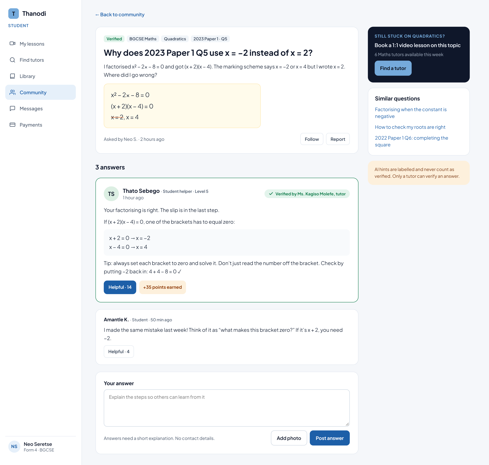

- "← Back to community".
- **Question card:**
  - Tags (status, curriculum, topic, and "2023 Paper 1 · Q5" when it's about a past paper).
  - The title (24/700), the body and an image of the student's working.
  - A footer with "Asked by Neo S. · 2 hours ago" and the buttons **Follow** and **Report**.
- "3 answers" heading.
- **Verified answer** (pinned first, 2px success border):
  - The author line "Thato Sebego · Student helper · Level 5" and the time.
  - A pill "✓ Verified by Ms. Kagiso Molefe, tutor".
  - A step-by-step explanation, which can include a math box on `--surface-subtle`.
  - **Helpful · 14** (pressed state) and a warning pill "+35 points earned".
- Other answers: plain cards with a **Helpful · N** button.
- **Your answer form:**
  - A textarea with the placeholder "Explain the steps so others can learn from it".
  - Caption: "Answers need a short explanation. No contact details."
  - Buttons **Add photo** and **Post answer**.
  - Validation: at least 40 characters. Block phone numbers, emails and URLs with an inline error.
- **Side column:**
  - Navy card "STILL STUCK ON QUADRATICS?" with "Book a 1:1 video lesson on this topic", "6 Maths
    tutors available this week" and **Find a tutor** (links to Find tutors pre-filtered).
  - **Similar questions** (3 links).
  - A warning note: "AI hints are labelled and never count as verified. Only a tutor can verify an answer."

---

### 7.9 Student · Leaderboard — `/student/community/leaderboard`

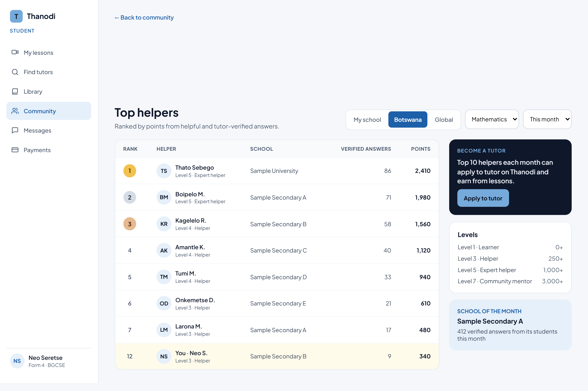

- "← Back to community", the title "Top helpers" and the subtitle "Ranked by points from helpful and
  tutor-verified answers."
- Filters: a scope segmented control **My school | Botswana | Global** (default Botswana), plus
  Subject and Period selects ("This month" / "All time").
- **Table:** RANK · HELPER · SCHOOL · VERIFIED ANSWERS · POINTS (scrolls horizontally on small screens).
  - Ranks 1–3 get medal circles: gold `#F2C14E`, silver `#D5DCE5`, bronze `#E7B98F`.
  - Each helper cell has an avatar, the name and the level ("Level 5 · Expert helper").
  - The current user's row is highlighted with `#FFFBEB` and labelled "You · Neo S.". If they're
    outside the top rows, it shows after a gap.
  - **Use sample school names** in mock data ("Sample Secondary A"…), never real schools with invented stats.
- **Side column:**
  - **Become a tutor** (navy): "Top 10 helpers each month can apply to tutor on Thanodi and earn from
    lessons." and an **Apply to tutor** button.
  - **Levels:** Level 1 Learner 0+, Level 3 Helper 250+, Level 5 Expert helper 1,000+, Level 7
    Community mentor 3,000+.
  - **School of the month** (`--accent`).

---

### 7.10 Messages (student, parent, tutor) — `/…/messages`

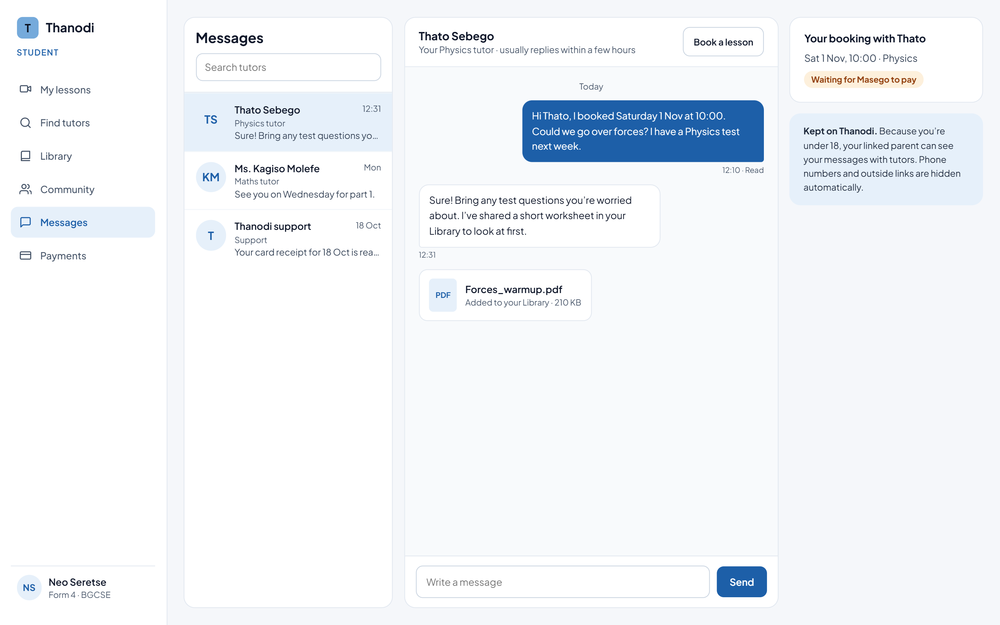
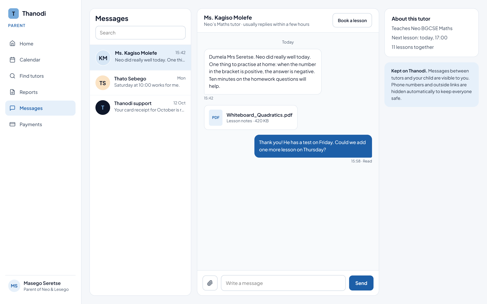
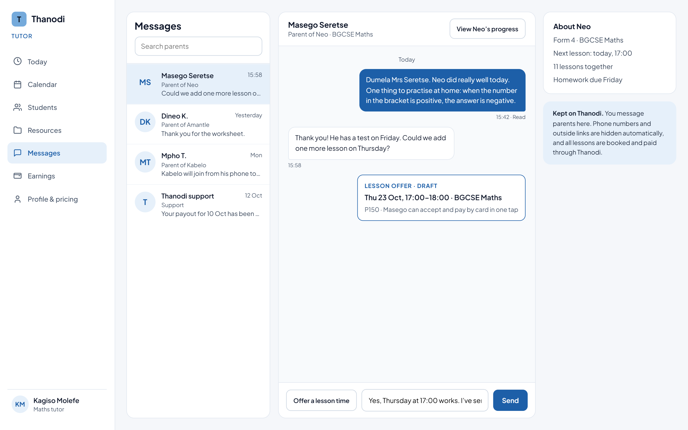

**One `MessagesLayout` component with three columns** inside the content area (padding 24px):

```
┌── Threads (flex 1, ≥260) ─┐ ┌────── Conversation (flex 3, ≥420) ──────┐ ┌─ Context (flex 1, ≥240) ┐
│ Messages                  │ │ Ms. Kagiso Molefe            [Book a    │ │ About this tutor        │
│ [Search…]                 │ │ Neo’s Maths tutor · replies… lesson]    │ │ Teaches Neo BGCSE Maths │
│▌(KM) Ms. Kagiso  15:42    │ │ ─────────────────────────────────────── │ │ Next lesson: today 17:00│
│▌ Neo did really well…     │ │              Today                      │ │ 11 lessons together     │
│ (TS) Thato Sebego   Mon   │ │ ┌─────────────┐                         │ ├─────────────────────────┤
│  Saturday at 10:00 works… │ │ │ them        │                         │ │ Kept on Thanodi. …      │
│ (T) Thanodi support 12 Oct│ │ └─────────────┘           ┌──────────┐  │ │ safety note (--accent)  │
│                           │ │ [PDF Whiteboard_…pdf]     │ me (blue)│  │ └─────────────────────────┘
│                           │ │                           └──────────┘  │
│                           │ │ [📎] [Write a message…]        [Send]   │
└───────────────────────────┘ └─────────────────────────────────────────┘
```

**Thread list:**
- Each row is a link with a 44px avatar, name, time, a "Parent of Neo" / "Physics tutor" line (tutor
  and student views) and a one-line preview with ellipsis.
- The selected row has an `--accent` background.

**Conversation header:** the name, a role line, and an action:

| Viewer | Action button |
| --- | --- |
| Parent / student | **Book a lesson** |
| Tutor | **View Neo’s progress** |

**Bubbles** (max 70% width):

| Sender | Alignment | Look |
| --- | --- | --- |
| Me | Right | `--primary` background, white text, radius `14 14 4 14` |
| Them | Left | White background, 1px border, radius `14 14 14 4` |

- Under each bubble: the time, plus "· Read" on my last message.
- Date separators ("Today") are centred and muted.

**Special message types:**
- **File attachment:** a PDF tile, name and size. Shared files are also added to the student's Library.
- **Lesson offer** (tutor → parent or student): a card with a 2px `--primary` border, the eyebrow
  "LESSON OFFER", "Thu 23 Oct, 17:00–18:00 · BGCSE Maths" and "P150 · Masego can accept and pay by
  card in one tap".
  - The recipient sees **Accept and pay**, which opens checkout pre-filled.
  - The tutor composes offers with an **Offer a lesson time** button next to the input.

**Composer:** an attach button, a text input and **Send**. Before sending, mask phone numbers, emails
and URLs and show the note "Contact details are hidden to keep everyone safe."

**Context aside, by viewer:**

| Viewer | Context card | Safety note |
| --- | --- | --- |
| Parent | About this tutor | "**Kept on Thanodi.** Messages between tutors and your child are visible to you. Phone numbers and outside links are hidden automatically to keep everyone safe." |
| Student | Your booking with Thato, including a "Waiting for Masego to pay" pill | "…Because you’re under 18, your linked parent can see your messages with tutors…" |
| Tutor | About Neo | "…all lessons are booked and paid through Thanodi." |

**Phone:** show the thread list first. Selecting a thread shows the conversation full screen with a
back button. The context aside goes into a sheet opened from an ⓘ button.

---

### 7.11 Student · Payments — `/student/payments`

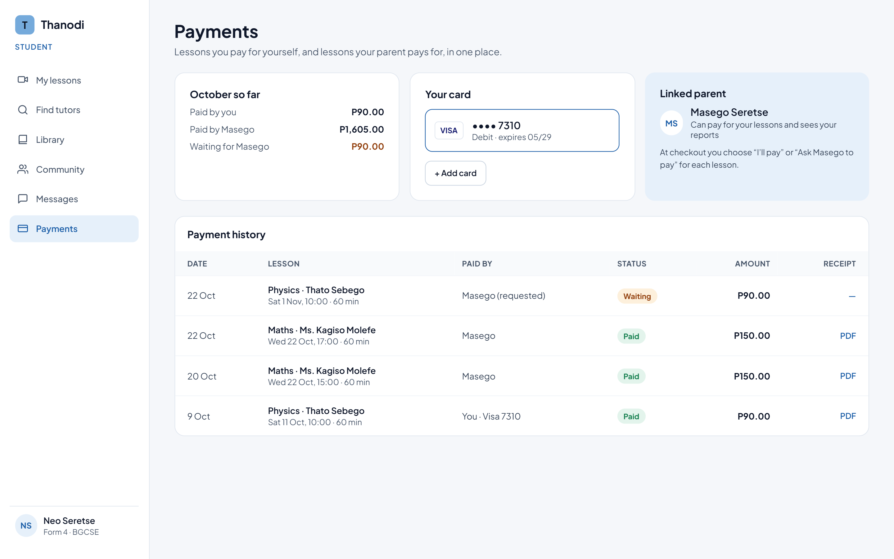

- The title and the subtitle "Lessons you pay for yourself, and lessons your parent pays for, in one place."
- Three cards in a row:
  1. **October so far:** Paid by you **P90.00**, Paid by Masego **P1,605.00**, Waiting for Masego
     **P90.00** (in warning colour).
  2. **Your card:** "VISA •••• 7310 · Debit · expires 05/29" in a 2px primary box, plus **+ Add card**.
  3. **Linked parent** (`--accent`): an avatar, "Masego Seretse", "Can pay for your lessons and sees
     your reports", and "At checkout you choose “I’ll pay” or “Ask Masego to pay” for each lesson."
- **Payment history table:** DATE · LESSON (title and detail) · PAID BY · STATUS · AMOUNT · RECEIPT.

  | Paid by values | Status values |
  | --- | --- |
  | "You · Visa 7310", "Masego", "Masego (requested)" | Paid (success), Waiting (warning) |

  The receipt column shows "PDF" or "—".

---

### 7.12 Student · Profile — `/student/profile`

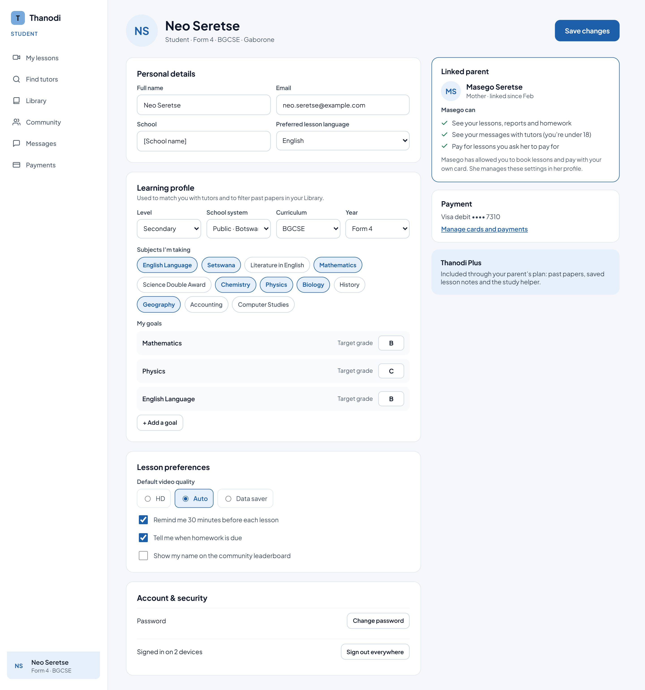

- **Header:** a 72px avatar, "Neo Seretse", "Student · Form 4 · BGCSE · Gaborone" and **Save changes**.
- **Main column cards:**
  1. **Personal details** (2-column grid): Full name, Email, School (`[School name]`), and Preferred
     lesson language (English / Setswana / Either).
  2. **Learning profile.** Subtitle: "Used to match you with tutors and to filter past papers in your Library."
     - Four selects: Level, School system, Curriculum, Year. The options cascade from `curricula.ts`,
       and Year depends on the curriculum: Form 1–3 for JCE, Form 4–5 for BGCSE/BSSE, Standard 1–7 for
       PSLE, and so on.
     - "Subjects I’m taking": the curriculum's subjects as toggle chips.
     - "My goals": rows of subject and target grade, plus **+ Add a goal**.
  3. **Lesson preferences:**
     - Default video quality as tile radios: HD / **Auto** / Data saver.
     - Checkboxes: "Remind me 30 minutes before each lesson", "Tell me when homework is due", "Show my
       name on the community leaderboard" (off by default).
  4. **Account & security:** Password → **Change password**; "Signed in on 2 devices" → **Sign out everywhere**.
- **Side column:**
  1. **Linked parent** (2px primary border):
     - "Masego Seretse · Mother · linked since Feb".
     - "Masego can" with ticks: "See your lessons, reports and homework", "See your messages with
       tutors (you’re under 18)", "Pay for lessons you ask her to pay for".
     - Note: "Masego has allowed you to book lessons and pay with your own card. She manages these
       settings in her profile."
  2. **Payment:** "Visa debit •••• 7310" and **Manage cards and payments**.
  3. **Thanodi Plus** (`--accent`): "Included through your parent’s plan…".
- The learning profile drives the Find tutors defaults (section 7.4) and the Library's subject filter.

---

### 7.13 Parent · Home — `/parent`

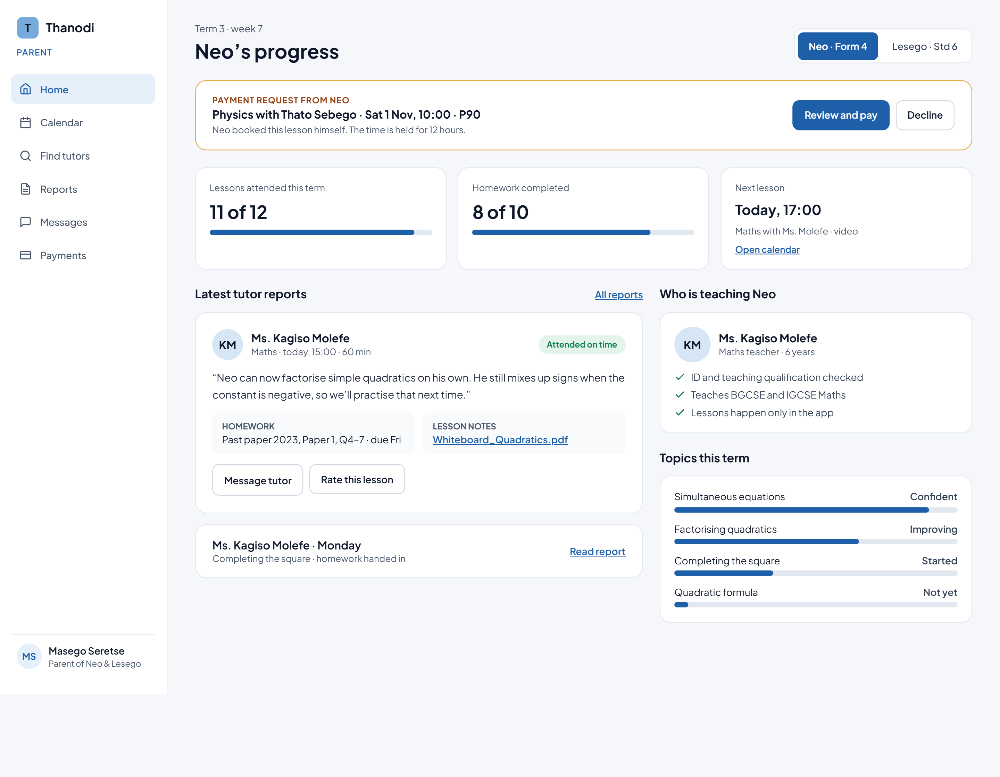

- **Header:** eyebrow-ish "Term 3 · week 7", the title "Neo’s progress", and on the right a child
  switcher segmented control **Neo · Form 4 | Lesego · Std 6** that writes `?child=`.
- **Payment request banner** (`PaymentRequestBanner`, 2px `--highlight-border`). Show it only when
  requests exist; if there are several, stack them.
  - Eyebrow "PAYMENT REQUEST FROM NEO".
  - "Physics with Thato Sebego · Sat 1 Nov, 10:00 · P90".
  - "Neo booked this lesson himself. The time is held for 12 hours."
  - **Review and pay** (opens checkout pre-filled) and **Decline**, which opens a confirm dialog
    with an optional message to Neo.
- **Stat cards** (3 columns):

  | Card | Value | Extra |
  | --- | --- | --- |
  | Lessons attended this term | **11 of 12** | Progress bar |
  | Homework completed | **8 of 10** | Progress bar |
  | Next lesson | **Today, 17:00** | "Maths with Ms. Molefe · video" and an **Open calendar** link |

- **Main: Latest tutor reports** (with an **All reports** link). The newest report is a full card:
  - The tutor's avatar and name, "Maths · today, 15:00 · 60 min" and an attendance pill.
  - The quoted comment.
  - Two inset boxes: HOMEWORK ("Past paper 2023, Paper 1, Q4–7 · due Fri") and LESSON NOTES (a file link).
  - Buttons **Message tutor** and **Rate this lesson**.

  Older reports are compact rows with **Read report**.
- **Side column:**
  - **Who is teaching Neo:** a tutor card with ticks "ID and teaching qualification checked",
    "Teaches BGCSE and IGCSE Maths", "Lessons happen only in the app".
  - **Topics this term:** rows with the topic name, a label (Confident / Improving / Started / Not yet)
    and a progress bar at 90/65/35/5%.

---

### 7.14 Parent · Calendar — `/parent/calendar`

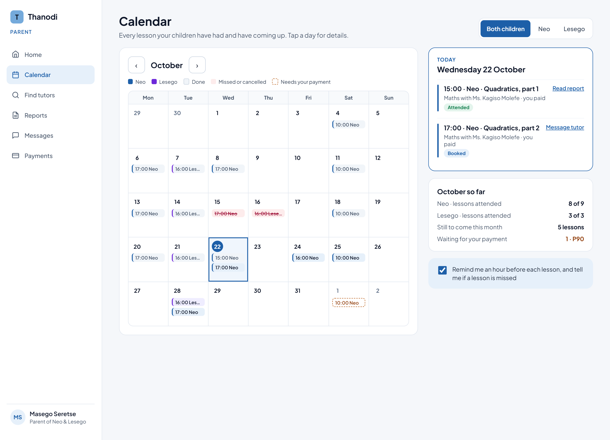

The same `MonthCalendar` as section 7.2, with **children as the colour key** instead of subjects.

- **Header:** the title, "Every lesson your children have had and have coming up. Tap a day for
  details." and a filter segmented control **Both children | Neo | Lesego**.
- **Legend:** Neo (`--cat-1`), Lesego (`--cat-3`), Done, Missed or cancelled, Needs your payment.
- **Chip text:** "16:00 Lesego".
- **Day panel, one row per lesson:**
  - "17:00 · Neo · Quadratics, part 2".
  - "Maths with Ms. Kagiso Molefe · you paid". The payer is one of "you paid", "Neo paid", "refunded"
    or "Neo asked you to pay".
  - A status pill and one action:

    | Status | Pill | Action |
    | --- | --- | --- |
    | Attended | success | **Read report** |
    | Missed | danger | **Message tutor** |
    | Cancelled · refunded | neutral | **Payments** |
    | Booked | info | **Message tutor** |
    | Needs your payment | warning | **Review and pay** |

- **Side column:**
  - **October so far:** Neo lessons attended **8 of 9**; Lesego **3 of 3**; still to come this month
    **5 lessons**; waiting for your payment **1 · P90**.
  - A checkbox card: "Remind me an hour before each lesson, and tell me if a lesson is missed".
- **Mock data must agree with the other screens:**
  - Neo's missed lesson on 15 Oct.
  - Lesego's cancelled lesson on 16 Oct, which also appears as a refund on Parent · Payments.
  - Neo's 11 Oct Physics lesson was paid by Neo.

---

### 7.15 Parent · Reports — `/parent/reports`

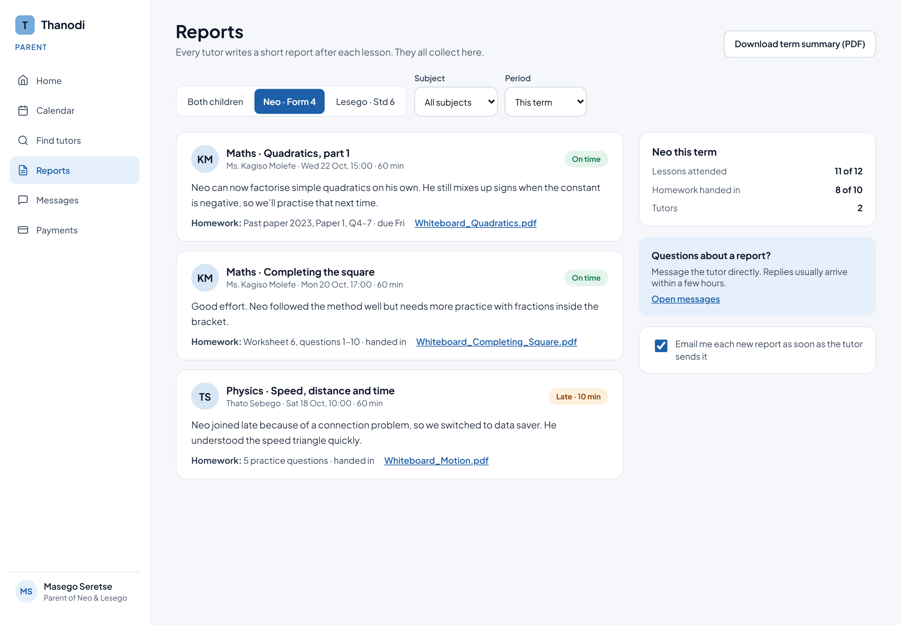

- **Header:** the title, "Every tutor writes a short report after each lesson. They all collect
  here." and **Download term summary (PDF)**.
- **Filters:** a child segmented control (Both / Neo / Lesego), a Subject select and a Period select
  (This term / Last 30 days / All time).
- **Report cards:**
  - The tutor's avatar, the topic "Maths · Quadratics, part 1" and the meta "Ms. Kagiso Molefe · Wed
    22 Oct, 15:00 · 60 min".
  - An attendance pill: "On time" (success) or "Late · 10 min" (warning).
  - The comment, "**Homework:** …" and a whiteboard file link.
- **Side column:**
  - **Neo this term** stats.
  - **Questions about a report?** with **Open messages**.
  - A checkbox card: "Email me each new report as soon as the tutor sends it".

---

### 7.16 Parent · Payments — `/parent/payments`

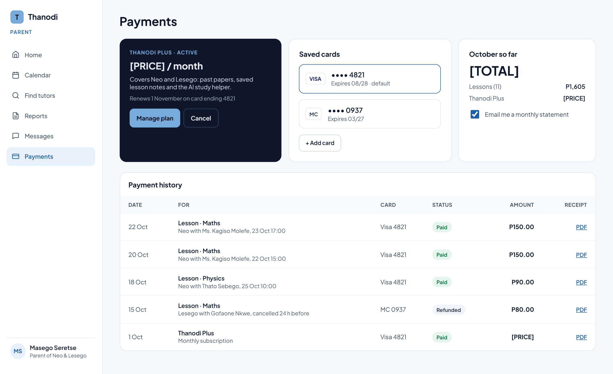

- **Three cards:**
  1. **Thanodi Plus · Active** (navy): "`[PRICE]` / month", "Covers Neo and Lesego: past papers,
     saved lesson notes and the AI study helper.", "Renews 1 November on card ending 4821", and the
     buttons **Manage plan** and **Cancel**.
  2. **Saved cards:** the default card (2px primary border) "VISA •••• 4821 · Expires 08/28 ·
     default", a second card "MC •••• 0937", and **+ Add card**.
  3. **October so far:** "`[TOTAL]`", Lessons (11) **P1,605**, Thanodi Plus `[PRICE]`, and a checkbox
     "Email me a monthly statement".
- **Payment history table:** DATE · FOR · CARD · STATUS · AMOUNT · RECEIPT. Statuses are Paid
  (success) and Refunded (neutral). The refund row is Lesego's 16 Oct lesson, "cancelled 24 h before".

---

### 7.17 Parent · Profile — `/parent/profile`

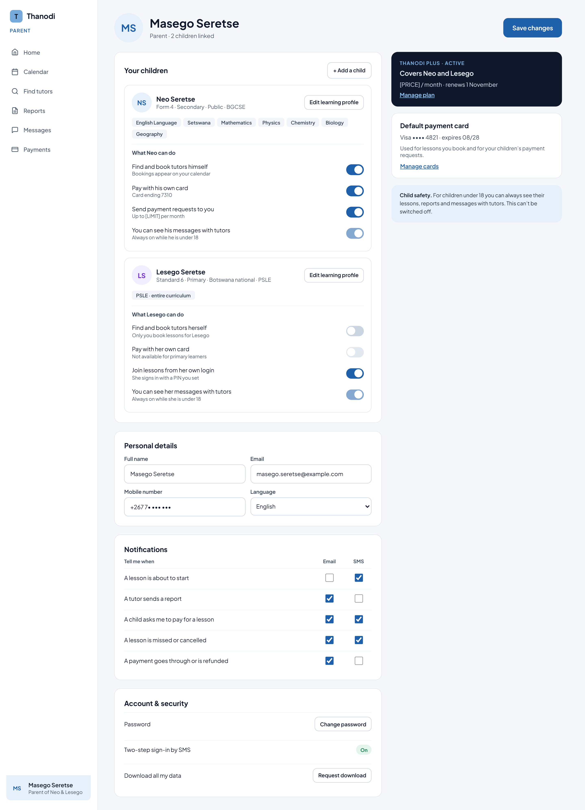

- **Header:** "Masego Seretse", "Parent · 2 children linked" and **Save changes**.
- **Your children** card (**+ Add a child**). One card per child:
  - Avatar, name and "Form 4 · Secondary · Public · BGCSE", with **Edit learning profile**.
  - Subject tags.
  - "What Neo can do": permission switches (`PermissionSwitchRow`):

    | Child | Permission | Hint | State |
    | --- | --- | --- | --- |
    | Neo | Find and book tutors himself | "Bookings appear on your calendar" | On |
    | Neo | Pay with his own card | "Card ending 7310" | On |
    | Neo | Send payment requests to you | "Up to `[LIMIT]` per month" | On |
    | Neo | You can see his messages with tutors | "Always on while he is under 18" | On, **locked** |
    | Lesego | Find and book tutors herself | "Only you book lessons for Lesego" | Off |
    | Lesego | Pay with her own card | "Not available for primary learners" | Off, **locked** |
    | Lesego | Join lessons from her own login | "She signs in with a PIN you set" | On |
    | Lesego | You can see her messages with tutors | — | On, **locked** |

- **Personal details:** Full name, Email, Mobile number (+267…), Language.
- **Notifications matrix:** columns Email and SMS; rows:
  - "A lesson is about to start"
  - "A tutor sends a report"
  - "A child asks me to pay for a lesson"
  - "A lesson is missed or cancelled"
  - "A payment goes through or is refunded"
- **Account & security:** Change password; Two-step sign-in by SMS (On pill); **Request download** of my data.
- **Side column:**
  - Thanodi Plus (navy) with **Manage plan**.
  - **Default payment card**: "Used for lessons you book and for your children’s payment requests."
  - **Child safety** note (`--accent`): "For children under 18 you can always see their lessons,
    reports and messages with tutors. This can’t be switched off."

---

### 7.18 Tutor · Today — `/tutor`

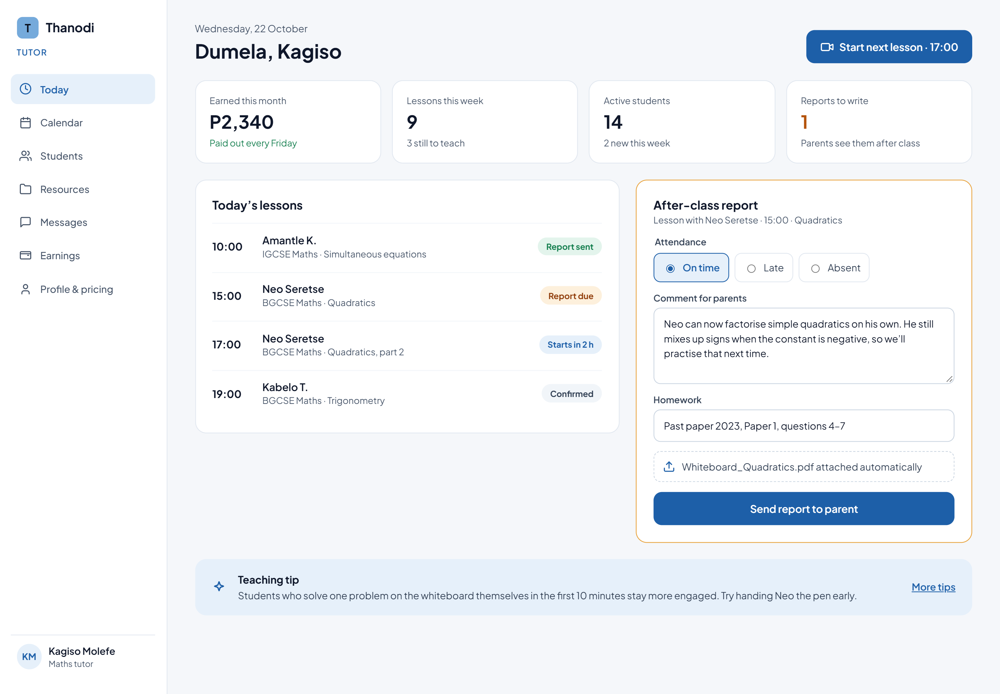

- **Header:** the date "Wednesday, 22 October", the greeting **"Dumela, Kagiso"** and the primary CTA
  **Start next lesson · 17:00** with a video icon, linking to `/lesson/[id]`.
- **Four stat cards:**

  | Card | Value | Subline |
  | --- | --- | --- |
  | Earned this month | P2,340 | "Paid out every Friday" (success) |
  | Lessons this week | 9 | "3 still to teach" |
  | Active students | 14 | "2 new this week" |
  | Reports to write | 1 (amber) | "Parents see them after class" |

- **Today’s lessons list:** rows of a time (bold, 56px wide), student name, "IGCSE Maths ·
  Simultaneous equations" and a status pill:

  | Pill | Colour |
  | --- | --- |
  | Report sent | success |
  | Report due | warning |
  | Starts in 2 h | info |
  | Confirmed | neutral |

- **After-class report** card (2px `--highlight-border`). This is the most important tutor form:
  - The heading and "Lesson with Neo Seretse · 15:00 · Quadratics".
  - **Attendance:** tile radios On time / Late / Absent. Choosing Late reveals a "Minutes late" input.
  - **Comment for parents:** a textarea, at least 30 characters.
  - **Homework:** a text input. Add an optional due-date picker if it's simple.
  - An attachment row: "Whiteboard_Quadratics.pdf attached automatically".
  - **Optional, recommended:** "Key takeaways" with up to 3 short lines. The AI draft is pre-filled
    and must be checked by the tutor, which drives the caption on the student's Lesson summary.
  - **Send report to parent**. Success toast: "Report sent to Masego". The lesson row changes to
    "Report sent".
- **Teaching tip** strip (`--accent`, sparkles icon): "Students who solve one problem on the
  whiteboard themselves in the first 10 minutes stay more engaged. Try handing Neo the pen early."
  Includes a **More tips** link to Resources.

---

### 7.19 Tutor · Calendar — `/tutor/calendar`

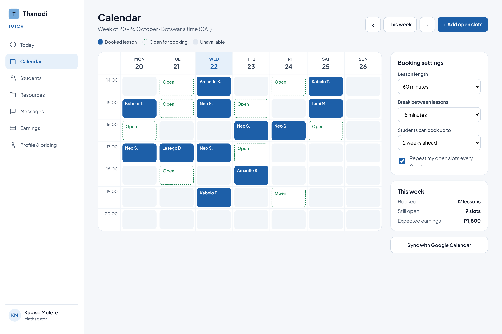

**A week view** (not a month view):
- **Header:** the title, "Week of 20–26 October · Botswana time (CAT)", ‹ **This week** › and
  **+ Add open slots**.
- **Legend:** Booked lesson (solid primary), Open for booking (2px dashed `--status-success-fg`),
  Unavailable (`--divider-soft`).
- **Grid:**
  - A time column, then Mon–Sun columns. Today's column header uses `--accent`.
  - Hour rows 14:00–20:00, each 64px tall.
  - Booked cells show the student name in white on primary. Open cells read "Open" in a green
    dashed box. Unavailable cells are plain grey.
  - **Interaction:** clicking an empty cell toggles open/unavailable. Clicking a booked cell opens
    a popover with the lesson details and **Message**.
- **Side column:**
  - **Booking settings:** Lesson length (60/45/30), Break between lessons (15 min / None / 30 min),
    Students can book up to (2 weeks / 1 week / 1 month ahead), and a checkbox "Repeat my open slots
    every week".
  - **This week:** Booked **12 lessons**, Still open **9 slots**, Expected earnings **P1,800**. These
    must match the grid's counts, so compute them, don't hard-code.
  - **Sync with Google Calendar** (secondary button, UI only).

---

### 7.20 Tutor · Students — `/tutor/students`

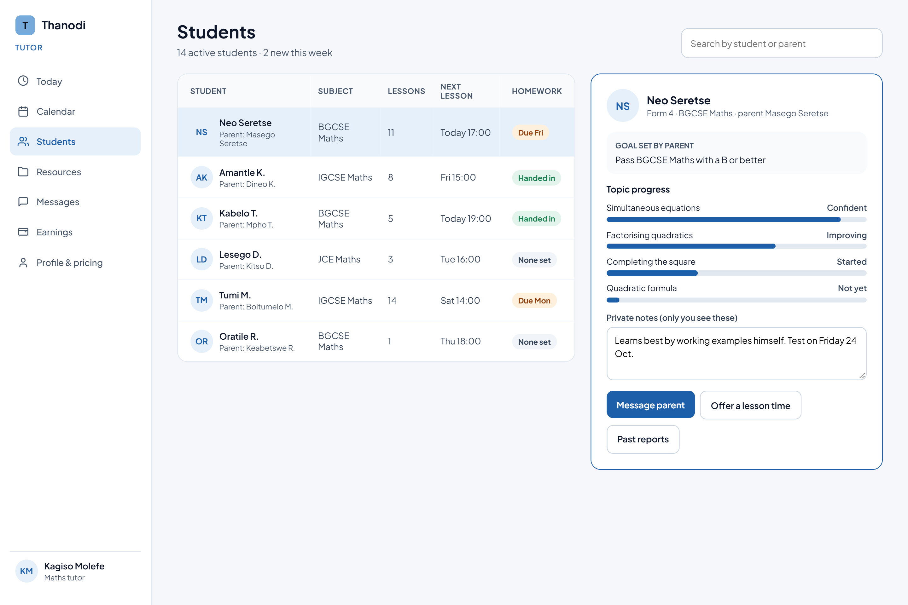

- **Header:** the title, "14 active students · 2 new this week" and a search input "Search by
  student or parent".
- **Table:** STUDENT (avatar, name, "Parent: Masego Seretse") · SUBJECT · LESSONS · NEXT LESSON ·
  HOMEWORK (pill: Due Fri / Handed in / None set).
  - Clicking a row selects it (`?student=`), and the selected row gets an `--accent` background.
- **Selected student panel** (2px primary border):
  - Avatar, name and "Form 4 · BGCSE Maths · parent Masego Seretse".
  - An inset box "GOAL SET BY PARENT": "Pass BGCSE Maths with a B or better".
  - **Topic progress** bars.
  - **Private notes (only you see these)** textarea.
  - Actions: **Message parent**, **Offer a lesson time** and **Past reports**.

---

### 7.21 Tutor · Resources — `/tutor/resources`

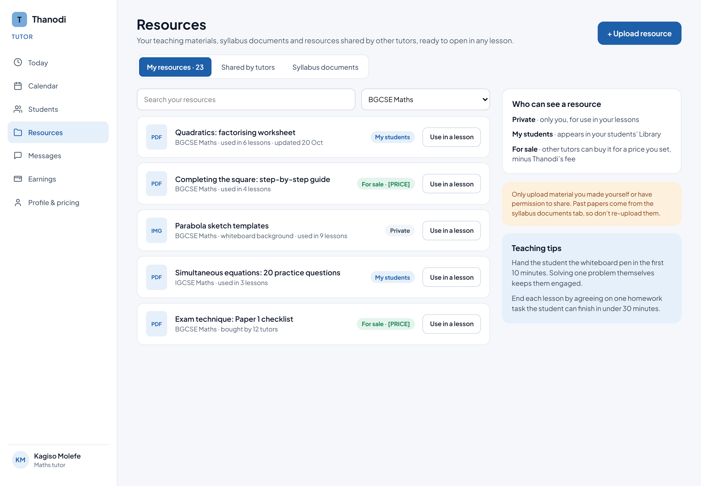

- **Header:** the title, "Your teaching materials, syllabus documents and resources shared by other
  tutors, ready to open in any lesson." and **+ Upload resource**, which opens a dialog: file, title,
  curriculum and subject, visibility, and a price if "For sale".
- **Tabs:** **My resources · 23**, **Shared by tutors**, **Syllabus documents**.
- A search input and a syllabus select.
- **Resource rows:** a type tile (PDF/IMG), the title, meta ("BGCSE Maths · used in 6 lessons ·
  updated 20 Oct"), a visibility pill and **Use in a lesson**.

  | Visibility | Pill colour |
  | --- | --- |
  | Private | neutral |
  | My students | info |
  | For sale · `[PRICE]` | success |

- **Side column:**
  - **Who can see a resource:**
    - **Private**: only you, for use in your lessons.
    - **My students**: appears in your students’ Library.
    - **For sale**: other tutors can buy it for a price you set, minus Thanodi’s fee.
  - A copyright warning in warning colours: "Only upload material you made yourself or have
    permission to share. Past papers come from the syllabus documents tab, so don’t re-upload them."
  - **Teaching tips** (`--accent`).

---

### 7.22 Tutor · Earnings — `/tutor/earnings`

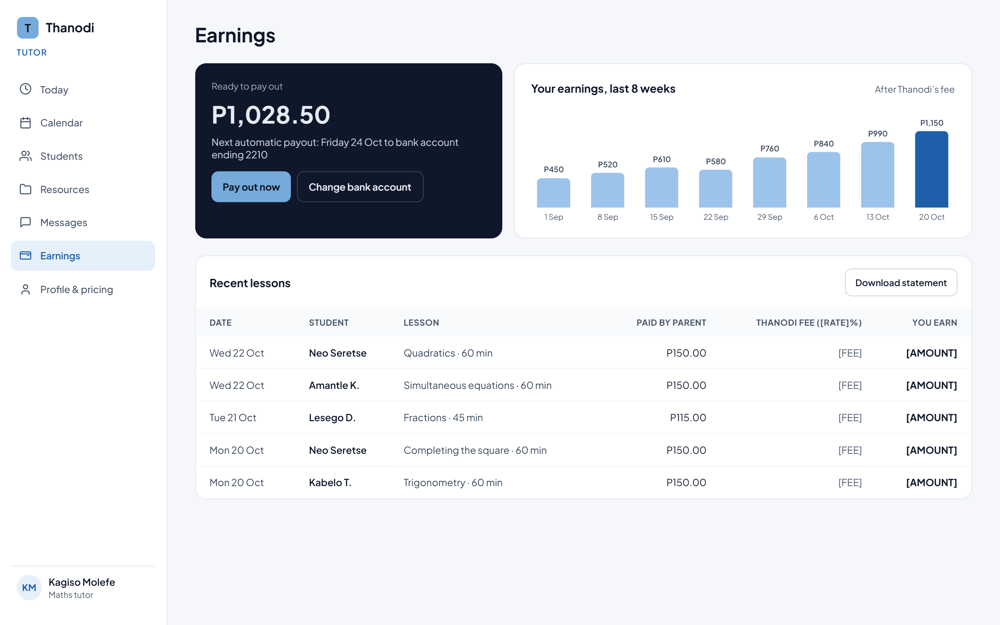

- **Payout card** (navy):
  - "Ready to pay out", **P1,028.50** and "Next automatic payout: Friday 24 Oct to bank account ending 2210".
  - Buttons **Pay out now** (accent-on-navy) and **Change bank account** (outline-on-navy).
- **Chart card:** "Your earnings, last 8 weeks", subtitle "After Thanodi’s fee".
  - A **vertical bar chart** with 8 weeks (1 Sep – 20 Oct) and values P450 → P1,150.
  - Bars use `--cat-1-light`; the latest week is solid `--primary`. Label each bar with its value.
  - Use the shadcn chart component (Recharts) with no gridlines and no legend.
  - Give it an `aria-label` that summarises the data.
- **Recent lessons statement table:** DATE · STUDENT · LESSON · PAID BY PARENT · THANODI FEE
  (`[RATE]`%) · YOU EARN. Fee and net show `[FEE]` / `[AMOUNT]` until the rate is decided.
  - **Download statement** button.

---

### 7.23 Tutor · Profile & pricing — `/tutor/profile`

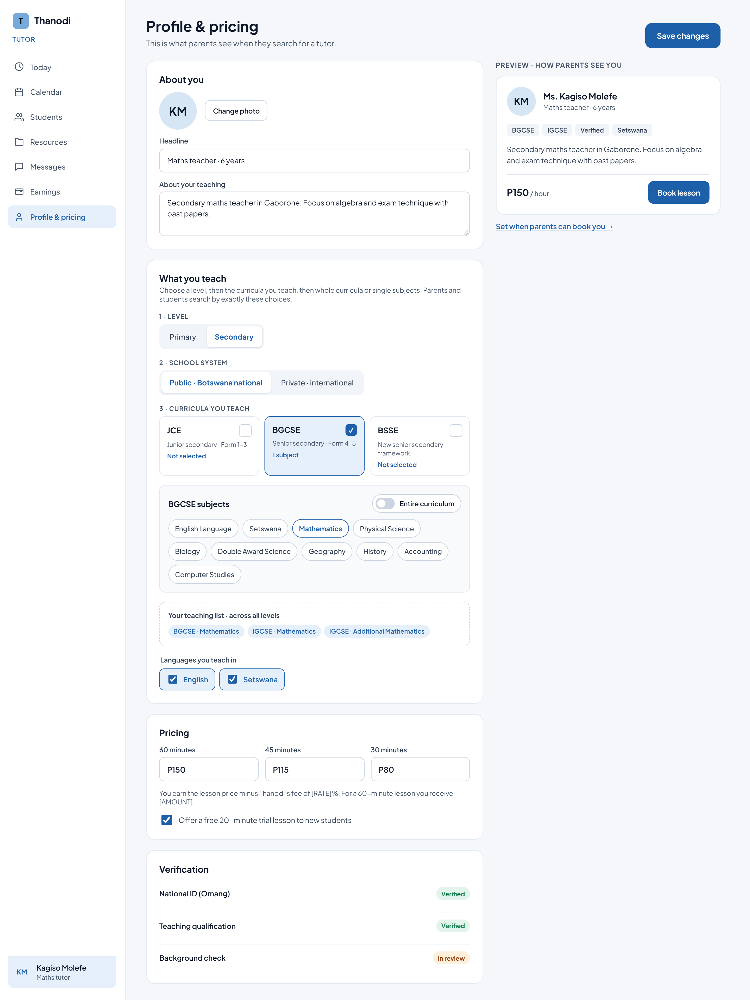

**Purpose:** what parents see in search, and what the tutor teaches.

**Main column cards:**
1. **About you:** photo with **Change photo**, a Headline input ("Maths teacher · 6 years") and an
   "About your teaching" textarea.
2. **What you teach** (`TeachingPicker`). This writes `TutorOffering[]`. See the flow in section 8.6.
   - **Step 1, Level:** segmented control Primary | Secondary.
   - **Step 2, School system:** **Secondary only**. Segmented control "Public · Botswana national" |
     "Private · international".
   - **Step 3 (or 2 for primary), Curricula you teach:** a 3-column grid of selectable cards. Each card
     has a checkbox tick, the name, a description (e.g. "Senior secondary · Form 4–5") and a status
     line: "Not selected" / "Pick subjects below" / "1 subject" / "Entire curriculum". Cards toggle.
     - Primary shows PSLE, IB PYP and Cambridge Primary.
     - Public secondary shows JCE, BGCSE and BSSE.
     - Private secondary shows IGCSE, IB MYP, IB Diploma and A Levels. Use `TREE` from `curricula.ts`.
   - **Per selected curriculum,** a panel (`--surface-subtle`):
     - "BGCSE subjects", an **Entire curriculum** switch, and subject chips grouped by category.
     - Turning the switch on selects all chips. Unticking a chip while "entire" is on turns entire off
       and keeps the others selected.
     - Show the curriculum's `note` if it has one, e.g. BSSE's "being phased in" note.
     - Only allow the Entire switch when `allowEntireCurriculum` is true.
   - **Your teaching list** (dashed border): pills for every offering across all levels, e.g.
     "BGCSE · Mathematics", "IGCSE · Additional Mathematics", "PSLE · entire curriculum". Show
     "Nothing chosen yet." when empty.
   - **Languages you teach in:** English and Setswana tile checkboxes.
   - For IB Diploma subjects, add an SL/HL choice per subject (a small segmented control on the chip
     row). It isn't designed yet, so keep it minimal.
3. **Pricing:**
   - Three inputs: 60 minutes (P150), 45 minutes (P115), 30 minutes (P80).
   - Caption: "You earn the lesson price minus Thanodi’s fee of `[RATE]`%. For a 60-minute lesson you
     receive `[AMOUNT]`."
   - A checkbox "Offer a free 20-minute trial lesson to new students".
4. **Verification:** rows National ID (Omang) **Verified**, Teaching qualification **Verified**,
   Background check **In review**.

**Side column, preview:** the eyebrow "PREVIEW · HOW PARENTS SEE YOU" and a live `TutorCard` using the
current form values. Its tags are the selected curricula plus "Verified" and "Setswana". Below it is
the link "Set when parents can book you →" to the tutor calendar.

**Save:** the header **Save changes** button. Show a "You have unsaved changes" sticky bar on mobile
when the form is dirty.

---

## 8. Key flows (diagrams)

### 8.1 Booking and payment, including "Ask my parent to pay"

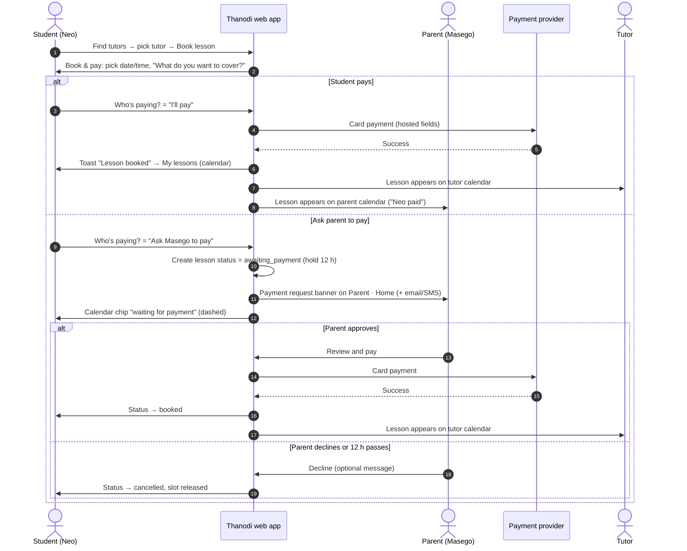

### 8.2 Lesson lifecycle (drives every status pill and calendar chip)

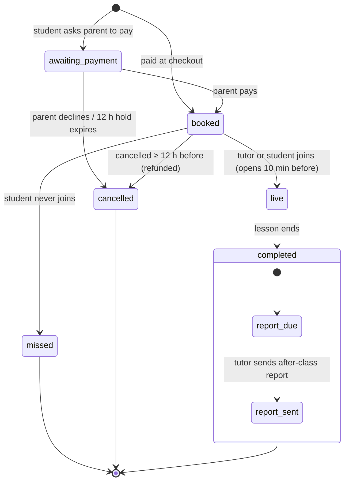

**Status to UI mapping (use one `lessonStatusView()` helper everywhere):**

| Lesson status | Student view | Parent view | Tutor view | Pill | Chip style |
| --- | --- | --- | --- | --- | --- |
| `awaiting_payment` | "Waiting for Masego to pay" | "Needs your payment" | (not shown until paid) | warning | dashed |
| `booked` (future) | "Booked · paid" | "Booked" | "Confirmed" | info / neutral | subject light |
| `booked` (today, < 2 h away) | "Starts in 1 h 52 min" | "Booked" | "Starts in 2 h" | info | subject light |
| `live` | "Live now · Join" | "Live now" | "Live now · Rejoin" | live | subject light |
| `completed` + `report_due` | "Done" | "Attended" | "Report due" | success / warning | done |
| `completed` + `report_sent` | "Done · View summary" | "Attended · Read report" | "Report sent" | success | done |
| `missed` | "Missed · Rebook" | "Missed" | "Absent" | danger | missed |
| `cancelled` | "Cancelled" | "Cancelled · refunded" | "Cancelled" | neutral | missed |

### 8.3 After the lesson: one report feeds three screens

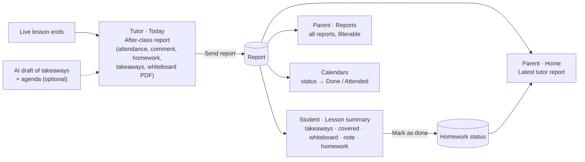

### 8.4 Joining a lesson

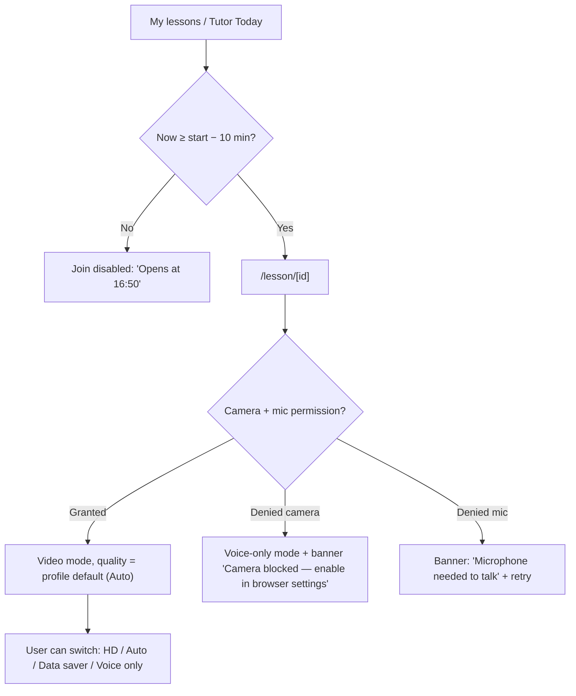

### 8.5 Find tutors filter cascade

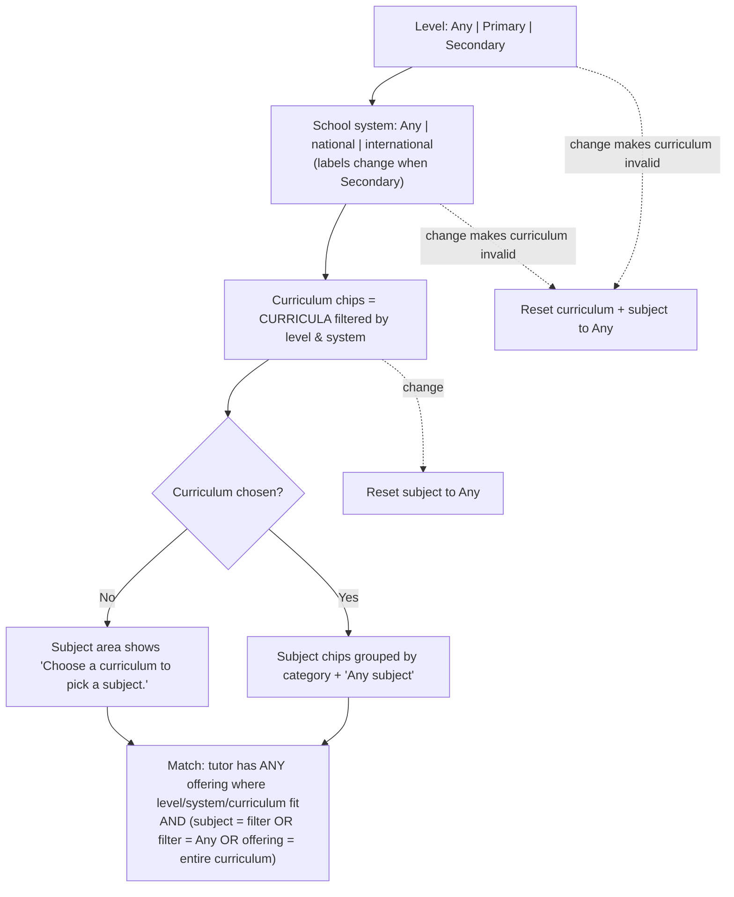

### 8.6 Tutor "What you teach"

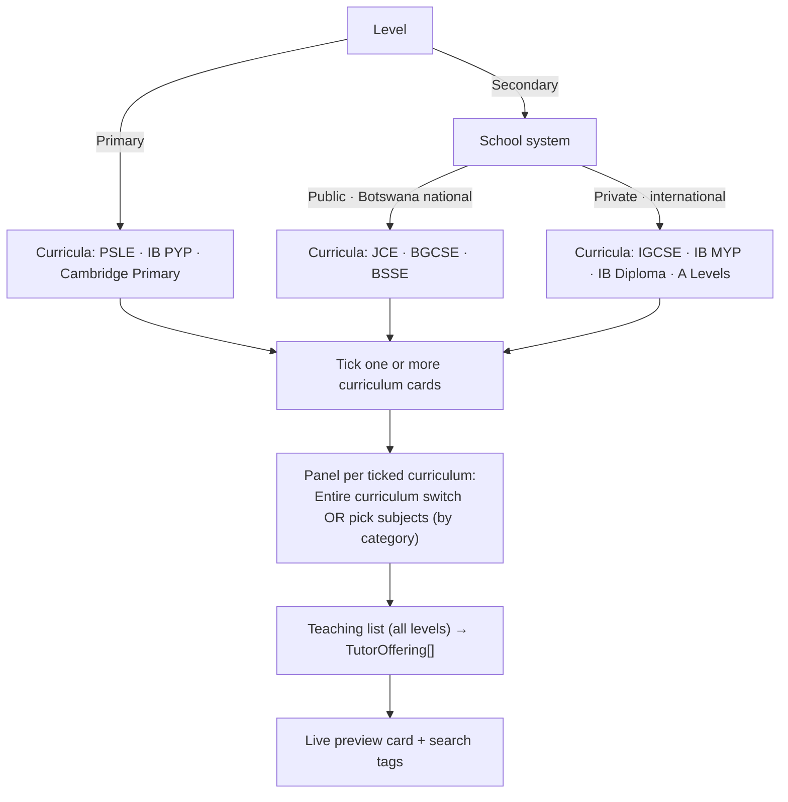

### 8.7 Community question to verified answer

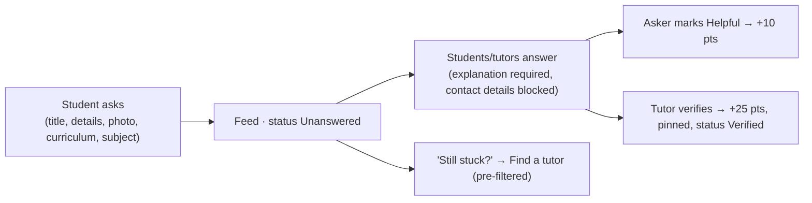

---

## 9. Shared component inventory

Build these once and reuse them. "shadcn" means the component is a thin wrapper over a shadcn
primitive.

### 9.1 Shell

| Component | Description |
| --- | --- |
| `AppShell` | Sidebar plus content area; takes `role`. On mobile it renders a `MobileTopBar` and `MobileTabBar` instead (section 12). |
| `RoleSidebar` | Built from `NAV[role]`, handles the active state and the account chip |
| `AccountChip` | Avatar, name and subline; links to `PROFILE_HREF[role]` |
| `PageHeader` | Optional eyebrow, title, subtitle, optional back link and right-side actions |
| `SectionCard` | White card with radius 16, 1px border, padding 20–24, optional title and action |

### 9.2 Display

| Component | Description |
| --- | --- |
| `StatusPill` | Props `tone: success \| info \| warning \| danger \| neutral \| live`, plus `children` |
| `Tag` | Small radius-6 label; `matched` makes it use info colours |
| `Avatar` | Initials on a hashed tint; sizes 36, 44, 48, 52, 56, 72, 140 (shadcn Avatar) |
| `StatCard` | Label, big number, subline, optional progress bar |
| `ProgressBar` | 8px track `--border` and fill `--primary` (shadcn Progress) |
| `NavyCard` | Hero or upsell card on `--navy`, with eyebrow in `--brand-sky` |
| `NoticeBox` | Info (`--accent`) or warning (warning colours) note with optional bold lead-in |
| `EmptyState` | Dashed card with text and an action |
| `DateTile` | Weekday over day number, used in upcoming lists |

### 9.3 Inputs

| Component | Description |
| --- | --- |
| `SegmentedControl` | shadcn ToggleGroup styled as in section 3.6 |
| `FilterChip` | Toggle chip with `aria-pressed` |
| `TileRadioGroup` | Big selectable radio tiles (Who's paying, Attendance, Video quality) |
| `PermissionSwitchRow` | Label, hint and switch, with a locked variant |
| `NotificationMatrix` | Rows × channels of checkboxes |

### 9.4 Domain

| Component | Description |
| --- | --- |
| `CurriculumFilter` | The full cascade from section 7.4, used by both Find tutors pages |
| `TeachingPicker` | Tutor "What you teach" (section 7.23) |
| `TutorCard` | Search result and preview card |
| `MonthCalendar` | Generic month grid. Props: `events`, `colorBy: (e) => catToken`, `selectedDate`, `onSelect` |
| `WeekAvailabilityGrid` | Tutor calendar grid |
| `DayPanel` | Selected-day list, using `lessonStatusView()` for the pill and action |
| `LessonRow` | Compact lesson row (upcoming, past, today) |
| `NextLessonHero` | Section 7.2 |
| `ReportCard` | Full and compact variants |
| `LessonSummaryView` | Section 7.3 sections |
| `PaymentRequestBanner` | Section 7.13 |
| `SlotPicker`, `WhoPaysPicker`, `CardForm`, `OrderSummary` | Booking |
| `SavedCards`, `PaymentHistoryTable` | Payments |
| `ThreadList`, `ChatThread`, `MessageBubble`, `AttachmentBubble`, `LessonOfferCard`, `Composer`, `SafetyNote` | Messages |
| `QuestionCard`, `AnswerCard`, `PointsCard`, `LeaderboardTable` | Community |
| `VideoStage`, `VoiceOnlyStage`, `SelfView`, `CallControls`, `QualitySwitch`, `LiveBadge`, `Whiteboard`, `LessonTools`, `StudyHelperSheet` | Lesson room |
| `EarningsChart` | Tutor · Earnings |
| `ResourceRow`, `UploadResourceDialog` | Tutor · Resources |

---

## 10. Data model and mock data

### 10.1 Entity diagram

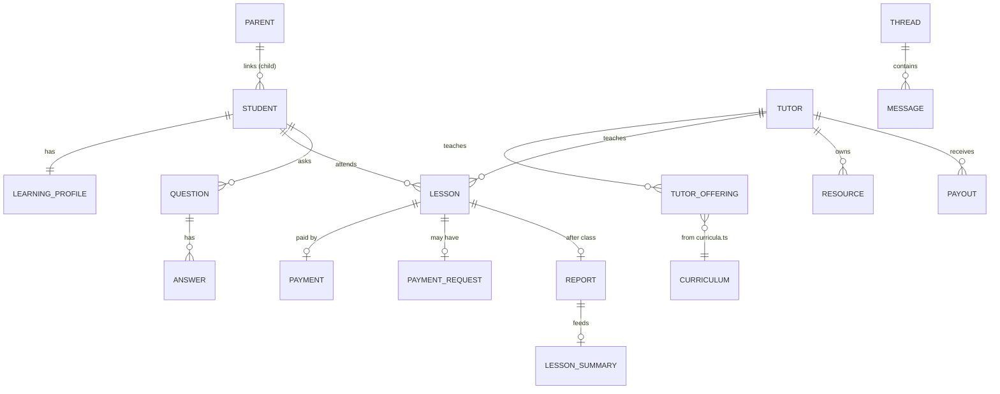

### 10.2 Types (`src/lib/types.ts`)

```ts
import type { Level, System } from "./curricula";

export type Role = "student" | "parent" | "tutor";
export type Money = number; // Pula, stored in thebe (P1 = 100 thebe) to avoid float errors

export interface UserBase {
  id: string; role: Role; fullName: string; firstName: string; initials: string;
  email: string; avatarUrl?: string;
}

export interface LearningProfile {
  level: Level; system: System; curriculumId: string;       // e.g. "bgcse"
  year: string;                                             // "Form 4", "Standard 6"
  subjectIds: string[];                                     // ids from curricula.ts
  goals: { subjectId: string; targetGrade: string }[];
  preferredLanguage: "English" | "Setswana" | "Either";
  school?: string;
}

export interface StudentPermissions {
  canBook: boolean; canPayOwnCard: boolean; canRequestParentPayment: boolean;
  monthlyRequestLimit?: Money; canJoinWithPin?: boolean;
}

export interface Student extends UserBase {
  role: "student"; isUnder18: boolean; linkedParentId?: string;
  learningProfile: LearningProfile; permissions: StudentPermissions;
  card?: SavedCard; points: number; communityLevel: number;
}

export interface Parent extends UserBase {
  role: "parent"; childIds: string[]; cards: SavedCard[]; plan?: Plan; phone?: string;
}

export interface TutorOffering {                       // matches curricula.ts
  curriculumId: string; subjectId?: string; entireCurriculum?: boolean; ibLevel?: "SL" | "HL";
}

export interface Tutor extends UserBase {
  role: "tutor"; headline: string; bio: string; offerings: TutorOffering[];
  languages: ("English" | "Setswana")[];
  prices: { min60: Money; min45: Money; min30: Money }; freeTrial: boolean;
  verification: { id: VerifyState; qualification: VerifyState; background: VerifyState };
  rating: number; lessonsTaught: number; nextFreeSlot?: string; // ISO
}
export type VerifyState = "verified" | "in_review" | "not_started";

export type LessonStatus = "awaiting_payment" | "booked" | "live" | "completed" | "missed" | "cancelled";
export interface Lesson {
  id: string; studentId: string; tutorId: string; curriculumId: string; subjectId: string;
  title: string; goal?: string; start: string; /* ISO, Africa/Gaborone */ durationMin: 30 | 45 | 60;
  status: LessonStatus; reportStatus?: "report_due" | "report_sent";
  payer: "student" | "parent"; paymentId?: string; paymentRequestId?: string;
  price: Money; refunded?: boolean;
}

export interface Report {
  id: string; lessonId: string; attendance: "on_time" | "late" | "absent"; lateMinutes?: number;
  comment: string; homework?: { text: string; due?: string; done: boolean };
  files: FileRef[]; takeaways?: string[]; aiDrafted?: boolean; tutorApproved?: boolean;
  agenda?: { time: string; title: string; detail: string }[]; sentAt: string;
}

export interface PaymentRequest {
  id: string; lessonId: string; fromStudentId: string; toParentId: string;
  amount: Money; expiresAt: string; status: "pending" | "paid" | "declined" | "expired";
}

export interface Payment {
  id: string; date: string; description: string; detail: string; payerLabel: string;
  cardLabel: string; status: "paid" | "refunded" | "waiting"; amount: Money | null; receiptUrl?: string;
}

export interface SavedCard { brand: "visa" | "mastercard"; last4: string; expiry: string; isDefault?: boolean; kind?: "debit" | "credit" }
export interface Plan { name: "Thanodi Plus"; price: Money | null; renewsOn: string; covers: string[] }
export interface FileRef { id: string; name: string; kind: "pdf" | "img"; sizeKb: number; url?: string }

export interface Thread { id: string; participantIds: string[]; aboutStudentId?: string; lastMessageAt: string; preview: string }
export interface Message {
  id: string; threadId: string; senderId: string; sentAt: string; readAt?: string;
  kind: "text" | "file" | "lesson_offer"; text?: string; file?: FileRef;
  offer?: { start: string; durationMin: number; curriculumId: string; subjectId: string; price: Money; status: "open" | "accepted" | "expired" };
}

export interface Question { id: string; authorId: string; title: string; body: string; imageUrl?: string;
  curriculumId: string; subjectId: string; topic?: string; pastPaperRef?: string;
  status: "unanswered" | "answered" | "verified"; createdAt: string; answerCount: number }
export interface Answer { id: string; questionId: string; authorId: string; body: string; helpfulCount: number;
  verifiedByTutorId?: string; createdAt: string }

export interface Resource { id: string; tutorId: string; title: string; kind: "pdf" | "img";
  curriculumId: string; subjectId?: string; visibility: "private" | "my_students" | "for_sale";
  price?: Money; usedInLessons: number; updatedAt: string }
```

### 10.3 Data-access layer (mock now, Supabase later)

Every page imports only from `src/lib/data/*`. Each function is `async` and returns typed data. In v1
they read from `src/lib/mock/*`.

```ts
// src/lib/data/lessons.ts
export async function getLessonsForStudent(studentId: string, month: string): Promise<Lesson[]>;
export async function getLessonsForParent(parentId: string, month: string, childId?: string): Promise<Lesson[]>;
export async function getTutorWeek(tutorId: string, weekStart: string): Promise<{ lessons: Lesson[]; open: Slot[] }>;
export async function getLessonSummary(lessonId: string): Promise<{ lesson: Lesson; report: Report }>;
// src/lib/data/tutors.ts
export async function searchTutors(filter: TutorFilter): Promise<Tutor[]>; // implements 7.4 matching
// src/lib/data/booking.ts
export async function createBooking(input: BookingInput): Promise<Lesson>;          // paid
export async function requestParentPayment(input: BookingInput): Promise<PaymentRequest>;
// …and similar for reports, messages, payments, community, resources, earnings, profiles.
```

Use server actions for mutations, e.g. `sendReport`, `markHomeworkDone` and `toggleSlot`, calling the
same data functions. Use `revalidatePath` after mutations.

### 10.4 Mock fixtures

Create `src/lib/mock/` with `users.ts`, `tutors.ts`, `lessons.ts`, `reports.ts`, `payments.ts`,
`messages.ts`, `community.ts` and `resources.ts`. Fill them from the screen specs above.

**The numbers must agree across screens:** attendance counts, payment totals, calendar chips, the
payment request and the refund. The key facts are listed below.

| Tutor | Offerings | Price | Rating · lessons · next free |
| --- | --- | --- | --- |
| Ms. Kagiso Molefe | BGCSE Mathematics; BSSE General & Scientific Mathematics; JCE Mathematics; IGCSE Mathematics & Additional Mathematics | P150 | 4.9 · 310 · Today 17:00 |
| Thato Sebego | BSSE Physics; BGCSE Physics, Mathematics, Science Double Award; JCE Integrated Science, Mathematics | P90 | 4.8 · 96 · Tomorrow 15:30 |
| Boitumelo Kgosi | IGCSE / A Level / IB Diploma / BGCSE Chemistry | P180 | 5.0 · 402 · Thu 18:00 |
| Onalenna Mosweu | BGCSE English Language & Literature; BSSE English; JCE English & Setswana; PSLE English & Setswana | P110 | 4.7 · 154 · Sat 10:00 |
| Lorato Dintwe | A Level Maths, Further Maths, Computer Science; IB DP Maths AA; IGCSE Computer Science | P200 | 4.9 · 88 · Fri 19:00 |
| Gofaone Nkwe | PSLE entire curriculum; Cambridge Primary Maths & Science; JCE Maths | P80 | 4.8 · 211 · Today 16:00 |
| Refilwe Kgari | IB PYP entire curriculum; Cambridge Primary English & Maths | P140 | 4.9 · 176 · Mon 15:00 |

**Other key facts:**
- Neo has a lesson today at 15:00 (done, report due → sent) and at 17:00 (next).
- Payment request: Physics with Thato, Sat 1 Nov 10:00, P90, pending, expires 12 h after creation.
- Lesego's 16 Oct lesson was cancelled and refunded P80.
- Neo's 11 Oct Physics lesson was paid by Neo with Visa 7310.

### 10.5 Curricula

`src/lib/curricula.ts` (provided) exports:
- `CURRICULA`: each curriculum with its categories and subjects.
- `TREE`: level → system → curriculum ids.
- `TutorOffering`.
- `getCurriculum(id)` and `subjectsByCategory(id)`.

Use it for every curriculum or subject UI: filters, the teaching picker, learning profiles, community
tags and resource tags. Display format is always **"<Curriculum short name> · <Subject name>"**, e.g.
"BGCSE · Mathematics".

---

## 11. Formatting, copy and localisation

Put all formatting in `src/lib/format.ts`.

| Thing | Format | Examples |
| --- | --- | --- |
| Money (lists, cards) | `P` + amount, thousands comma, no decimals if whole | P150, P2,340, P1,605 |
| Money (checkout, receipts, statements) | 2 decimals | P150.00, P1,028.50 |
| Price per hour | "P150 / hour" | |
| Date (short) | `EEE d MMM` | Wed 22 Oct |
| Date (long) | `EEEE d MMMM` | Wednesday 22 October |
| Time | 24-hour `HH:mm` | 17:00 |
| Time range | `HH:mm–HH:mm` (en dash) | 17:00–18:00 |
| Relative | "Today, 17:00", "Tomorrow 15:30", "2 h ago", "Yesterday" | |
| Countdown | "STARTS IN 1 H 52 MIN" (eyebrow), "Starts in 1 h 52 min" (pill) | |
| Time zone | Always **Africa/Gaborone (CAT, UTC+2)**. Label it "Botswana time (CAT)" where times are set. | |
| Phone | +267 7X XXX XXX | |
| Card | "Visa •••• 4821", "MC •••• 0937" | |

**Copy rules:**
- Use sentence case for buttons and headings ("Book lesson", not "Book Lesson"). Eyebrows are uppercase.
- Use curly quotes and apostrophes (’ “ ”) in UI text.
- Be short, warm and direct. Use Setswana greetings in welcomes ("Dumela, Kagiso").
- Placeholders in brackets (`[PRICE]`) must render visibly, styled as normal text.

**Localisation:** v1 is English. Setswana comes later, so keep user-facing strings out of deep logic
(component props or a `copy.ts` per feature), so you can add `next-intl` later without rewriting
components.

---

## 12. Responsive behaviour

| Breakpoint | Shell | Content |
| --- | --- | --- |
| **≥ 1024px** (`lg`) | Fixed 240px sidebar | Two-column layouts (main flex 3, side flex 2) |
| **640–1023px** | Sidebar hidden. Top bar with logo, page title and menu button that opens the sidebar in a shadcn `Sheet` from the left. | Columns stack; side column goes **below** main |
| **< 640px** | Top bar plus a **bottom tab bar** (64px, safe-area padding) with the role's first 4 nav items and **More**, which opens a sheet with the rest and the profile link | Single column, page padding 16px, tables scroll horizontally inside their card |

**Bottom tab bar items:**

| Role | Tabs |
| --- | --- |
| Student | My lessons, Find tutors, Library, Messages, More (Community, Payments, Profile) |
| Parent | Home, Calendar, Find tutors, Messages, More (Reports, Payments, Profile) |
| Tutor | Today, Calendar, Students, Messages, More (Resources, Earnings, Profile & pricing) |

**Per-screen notes:**
- **Calendars:** below 640px, show a compact month grid with dots instead of chips (one dot per
  lesson, in its colour), and the Day panel directly under it.
- **Find tutors:** below 1024px the filters go into a "Filters (3)" button that opens a bottom sheet;
  results take the full width.
- **Messages:** the list ⇄ conversation pattern described in section 7.10.
- **Lesson room:** the phone layout from section 7.1.
- **Tables** (leaderboard, students, payments, earnings): keep the table but wrap it in
  `overflow-x-auto` with min-width 560–640px.

---

## 13. Accessibility

- Text contrast is at least **4.5:1**. All token pairs above pass. Don't put muted text on `--accent`.
- Every interactive element is a native `<button>`, `<a href>` or `<input>` with a visible label.
  Icon-only buttons need an `aria-label`.
- The current nav item has `aria-current="page"`. Toggle chips and segmented items have `aria-pressed`.
  Switches have `role="switch"` and `aria-checked`.
- Status is never shown by colour alone: pills always contain text, and calendar chips include the
  time and subject or child.
- Each calendar cell's aria-label includes the date and lesson count. Arrow keys move between days.
- Focus ring: 2px `--ring`, 2px offset, visible on all controls.
- Tap targets are at least 44×44px.
- Decorative SVGs have `aria-hidden="true"`. Informative ones (charts, whiteboard thumbnails) have
  `role="img"` and an `aria-label`.
- Forms: errors appear under the field and are linked with `aria-describedby`. Focus moves to the
  first error on submit.
- Respect `prefers-reduced-motion` and avoid decorative animation.

---

## 14. Performance and low-data design

Many users are on paid mobile data. Treat bytes as the user's money.

- **Only the lesson room loads heavy libraries.** Excalidraw and the Stream SDK use `next/dynamic`
  with `ssr: false`, imported only under `/lesson/*`.
- Use Server Components by default to keep client JavaScript small.
- Images use `next/image` with explicit sizes. Avatars use initials, not photos, unless uploaded.
- One font family with 4 weights, loaded through `next/font` (self-hosted, no layout shift).
- Show data estimates wherever video quality is chosen.
- PWA: add `app/manifest.ts` (name "Thanodi", theme colour `#1D5FA8`, background `#F5F7FA`) so the app
  can be installed on a home screen. Add the offline service worker for the Library later.
- Don't show autoplaying video anywhere outside the lesson room.

---

## 15. Build order and acceptance checklist

Work in this order and finish each milestone before starting the next.

### M0: Foundations
- [ ] Next.js app with `src/`, Tailwind v4, shadcn (Base UI, Vega) initialised
- [ ] Tokens from section 3.8 in `globals.css`; Plus Jakarta Sans loaded
- [ ] shadcn components added: button, input, label, select, textarea, checkbox, radio-group, switch,
      tabs, toggle-group, badge, avatar, card, dialog, sheet, dropdown-menu, popover, table, progress,
      separator, scroll-area, tooltip, sonner, chart
- [ ] `src/lib/curricula.ts`, `types.ts`, `format.ts` and `permissions.ts` in place
- [ ] Mock fixtures and data-access functions (section 10)
- [ ] `src/config/nav.ts` and `placeholders.ts`
- **Accept when** a demo page shows every button, chip, pill and card variant using only tokens.

### M1: Shell
- [ ] `AppShell`, `RoleSidebar`, `AccountChip`, `PageHeader`; role layouts for student, parent and tutor
- [ ] Mobile top bar, sheet and bottom tab bar
- [ ] A role switcher in dev only (e.g. `?as=parent`) to preview roles without auth
- **Accept when** every route in section 6.1 renders a stub inside the correct shell with the correct
  active item, and every sidebar is identical within a role.

### M2: Find tutors and booking
- [ ] `CurriculumFilter` with exact cascade and matching (unit-test the matching function)
- [ ] `TutorCard`; parent context tiles; student profile-match box
- [ ] Book & pay for both roles, including Who's paying? and the payment request creation
- **Accept when** these checks pass:
  - Parent "Neo" shows 2 tutors (Molefe, Sebego) for BGCSE · Mathematics.
  - "Lesego" shows Mosweu and Nkwe for PSLE.
  - Switching Level to Primary clears an IB Diploma selection.

### M3: Lessons, calendars and reports
- [ ] `MonthCalendar`, `DayPanel`, `NextLessonHero`; Student · My lessons; Parent · Calendar
- [ ] Student · Lesson summary; Parent · Home (with payment request banner); Parent · Reports
- [ ] One `lessonStatusView()` used by every pill and chip
- **Accept when** the October mock data matches section 7.2 and section 7.14, and clicking days
  updates `?date=`.

### M4: Tutor workspace
- [ ] Today (after-class report form sends and updates status); Calendar week grid; Students; Resources;
      Earnings (chart); Profile & pricing with `TeachingPicker` and live preview
- **Accept when** sending a report changes "Report due" to "Report sent", and the student's summary
  and parent's reports show the new report (mock store in memory is fine).

### M5: Messages, payments, community, library, profiles
- [ ] `MessagesLayout` for all three roles, with lesson offers, attachments and contact masking
- [ ] Payments for student and parent; Library with study helper; Community, Question, Leaderboard
- [ ] Student and Parent profiles, with permission switches (locked ones disabled with hints)

### M6: Live lesson room
- [ ] Room UI with a mock `VideoStage`, `QualitySwitch`, voice-only mode, mute, controls, leave dialog
- [ ] Excalidraw whiteboard (dynamic import) with grid background and tool mapping
- [ ] Phone layout
- **Accept when** the quality switch, voice-only, mute and leave all behave as in section 7.1, and
  Excalidraw is not in any other route's bundle.

### M7: Polish
- [ ] Loading skeletons, empty states, error states for every page
- [ ] Responsive pass at 360, 768, 1024 and 1440px
- [ ] Accessibility pass (keyboard-only walkthrough of booking and the report form; axe has no
      serious issues)
- [ ] Visual check against every screenshot in `docs/design/screens/`

---

## 16. Placeholders and open decisions

### 16.1 Placeholders (render visibly; replace later)

```ts
// src/config/placeholders.ts
export const PLACEHOLDERS = {
  PLUS_PRICE: "[PRICE]",              // Thanodi Plus monthly price
  RESOURCE_PRICE: "[PRICE]",          // tutor resource sale price default
  FEE_RATE: "[RATE]",                 // Thanodi commission %
  TUTOR_NET: "[AMOUNT]",              // tutor take-home for 60 min
  FEE_AMOUNT: "[FEE]",
  PAYMENT_PROVIDER: "[PAYMENT PROVIDER]",
  PARENT_REQUEST_LIMIT: "[LIMIT]",    // monthly cap on child payment requests
  MONTH_TOTAL: "[TOTAL]",
  SCHOOL_NAME: "[School name]",
} as const;
```

### 16.2 Not designed yet: build simply, in the same style

| Item | What to build |
| --- | --- |
| Sign-in and sign-up | Email and password; role choice (student / parent / tutor); parent can add children; child PIN login |
| Onboarding | Learning profile for students; tutor "What you teach" and verification upload |
| Tutor public profile page | Full bio, all offerings grouped by curriculum, reviews, availability, **Book lesson** |
| Ask-a-question dialog | Section 7.7 |
| Upload-resource dialog | Section 7.21 |
| Reschedule dialog | Pick from the tutor's open slots |
| Notifications bell | List of recent events: report sent, payment request, lesson starting |
| 404 and error pages | Use the shell and `EmptyState` |

### 16.3 Decisions already made (don't change without asking)

- Video is the default and voice-only is optional. Quality defaults to Auto.
- Payments are card-only in v1. Live 1:1 lessons are not recorded.
- Parents always see under-18s' messages with tutors (locked).
- Primary-school learners cannot pay or book; their parent does.
- Students with a linked parent choose per lesson: "I'll pay" or "Ask parent to pay" (12-hour hold).
- Join opens 10 minutes before the start. Free cancellation is allowed up to 12 hours before.
- AI-drafted lesson takeaways must be approved by the tutor before students see them.

### 16.4 Still open (ask the product owner)

- Thanodi Plus price, commission rate and child payment-request limit.
- Payment provider (DPO, PaySwitch or similar). This decides the `CardForm` implementation.
- Whether older or self-funded students can sign up without a linked parent (UI already supports it).
- Final logo (the "T" mark is a placeholder).
- The final BSSE subject list (see the notes in `curricula.ts`).
